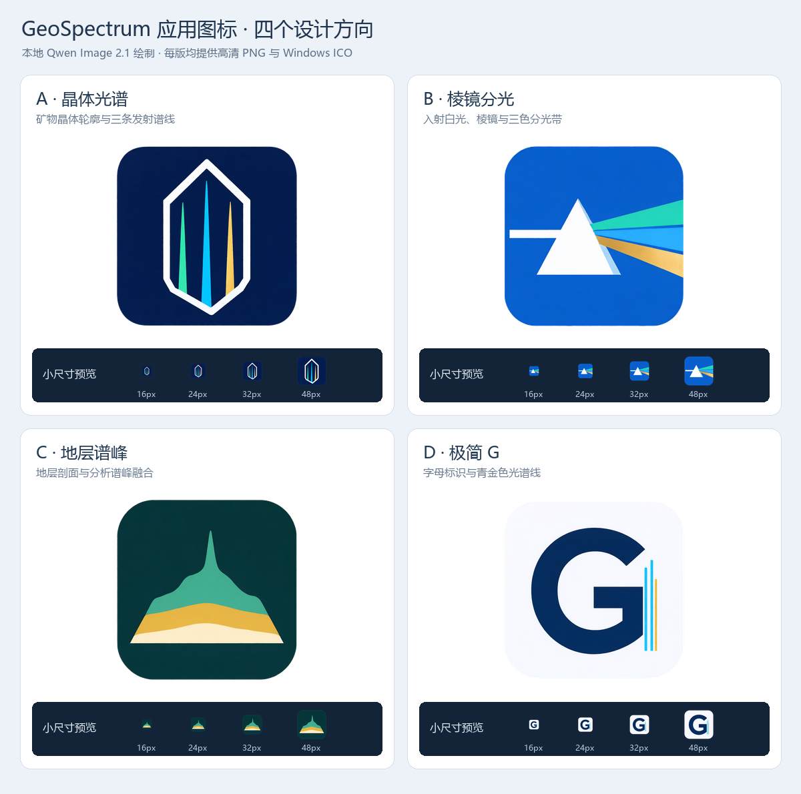

# GeoSpectrum 应用图标候选

2026-10-20，按用户“用Qwen绘制，可以多做几个设计，不一定保留原样”的要求，通过本机 `D:/Flux` 的 Qwen Image 2.1 绘制四个独立方案。此处归档候选设计及可用图标文件；生成批次当时尚未接入应用。

随后用户选择B“棱镜分光”，已用于程序、窗口及应用内品牌位置，见[接入验证](../2026-10-20-prism-app-icon/verification.json)。归档候选ICO保留原样；应用内ICO仅将256px帧前置，避免窗口读取16px帧后放大。

| 方案 | 设计方向 | 高清PNG | Windows ICO |
|---|---|---|---|
| A | 晶体光谱：矿物晶体与发射谱线，偏专业仪器 | [1024px](designs/A-crystal-1024.png) | [ICO](designs/A-crystal.ico) |
| B | 棱镜分光：直接表达光学与色散，缩小后轮廓鲜明 | [1024px](designs/B-prism-1024.png) | [ICO](designs/B-prism.ico) |
| C | 地层谱峰：将地质剖面与单个分析峰合为一个形状 | [1024px](designs/C-strata-1024.png) | [ICO](designs/C-strata.ico) |
| D | 极简G：字母品牌标识与青金色谱线，轻简风格 | [1024px](designs/D-monogram-1024.png) | [ICO](designs/D-monogram.ico) |

更推荐B用于直接表达光谱分析；D适合偏品牌化的简洁风格。该建议来自当前四款图片的视觉与小尺寸比较，不是完整用户测试结论。

[下载全部PNG/ICO及预览](GeoSpectrum-app-icon-designs.zip)。每款提供1024与512像素RGBA PNG，以及内含16、20、24、32、40、48、64、96、128、256像素帧的ICO。

## 生成与整理

- 本地模型：`qwen_image_2.1_int8_convrot.safetensors`，Qwen3-VL W4A8编码器、BF16 VAE；30步、CFG1、Euler/Simple、EasyCache与现有Kitchen Attention链路。四版均从文本独立生成1024×1024原图，没有用旧图标约束图形。
- 提示词：[A](generation/prompt-v1.txt)、[B](generation/B-prism-prompt.txt)、[C](generation/C-strata-prompt.txt)、[D](generation/D-monogram-prompt.txt)。对应请求工作流和原始生成图位于同一目录。
- 种子：A为2026102020，B为2026102021，C为2026102022，D为2026102023。
- 后处理：A/B/C按边界连通的近白底提取外部透明区，内部白色图形保持；D的冷白底板使用圆角透明蒙版保留完整底板。四款统一外部边距，并生成各尺寸PNG/ICO。未重绘核心图形。
- 所有任务成功、`node_errors`为空；本机默认工作流和服务配置保持，无外部提示词扩写调用。
- 已检查PNG透明通道、ICO全部10帧尺寸及对比图。未构建新EXE，未修改应用代码、现有图标、快捷栏、后端或用户数据库。验证见 [verification.json](verification.json)。
