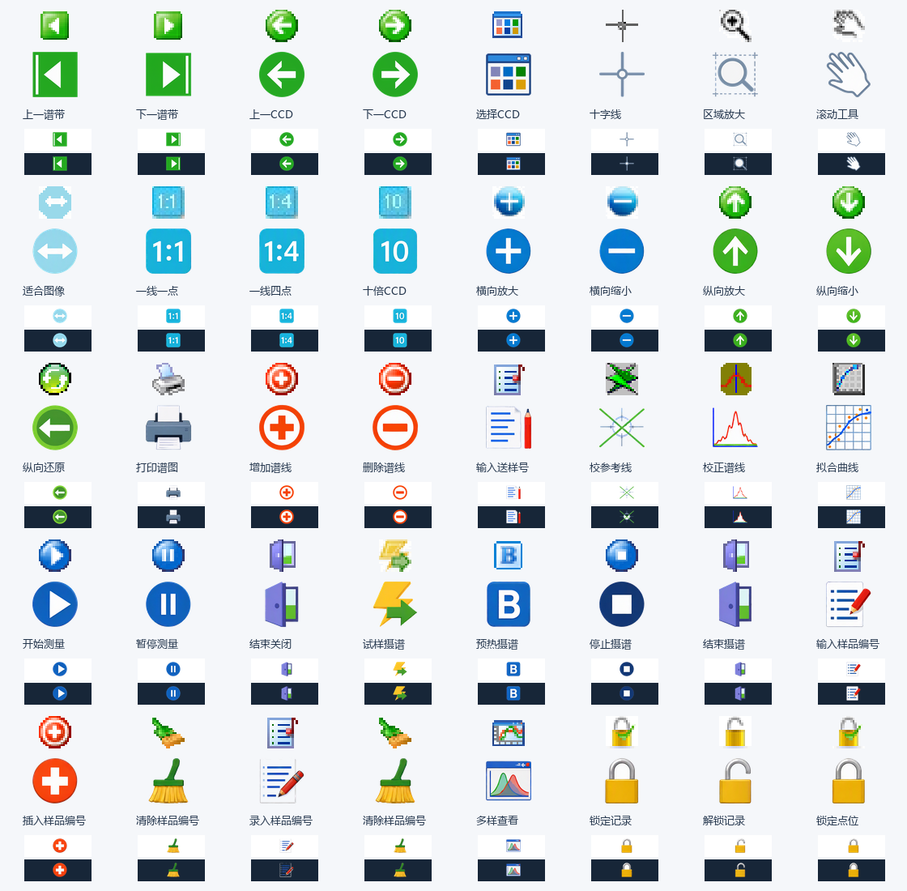

# 40枚图标生成记录

使用本地 `D:/Flux` ComfyUI 的 Qwen Image 2.1 INT8 ConvRot、Qwen3-VL W4A8、BF16 VAE。五张1536×768参考图分别编辑生成，每张30步、CFG1、Euler/Simple，seed为2026102540至2026102544。未使用云端图像或提示词服务。最终资源在 `app/frontend/src/assets/spectroscopy/`，逐枚来源与文件名见[清单](catalog.json)。

| 批次 | 提示词 | 原始参考 | Qwen生成 | 工作流 |
|---|---|---|---|---|
| 1 | [提示词1](prompt-1.txt) | [参考1](reference-1.png) | [生成1](generated-1.png) | [工作流1](workflow-1.json) |
| 2 | [提示词2](prompt-2.txt) | [参考2](reference-2.png) | [生成2](generated-2.png) | [工作流2](workflow-2.json) |
| 3 | [提示词3](prompt-3.txt) | [参考3](reference-3.png) | [生成3](generated-3.png) | [工作流3](workflow-3.json) |
| 4 | [提示词4](prompt-4.txt) | [参考4](reference-4.png) | [生成4](generated-4.png) | [工作流4](workflow-4.json) |
| 5 | [提示词5](prompt-5.txt) | [参考5](reference-5.png) | [生成5](generated-5.png) | [工作流5](workflow-5.json) |

每格提取后仅移除与边界相连的近白底，保留内部白色，统一224像素主体与256像素透明画布；界面20 CSS像素平滑显示。已核对方向、比例数字、B字母及锁定/解锁区别，40枚均有透明与不透明像素。

功能对应见[实施对照](实施对照.md)，软件和桌面结果见[验证](verification.json)。
