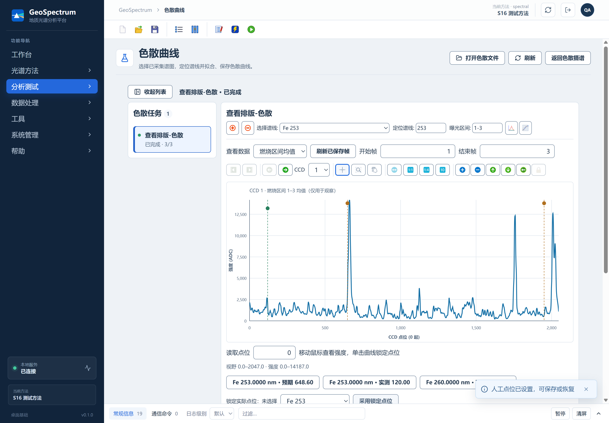
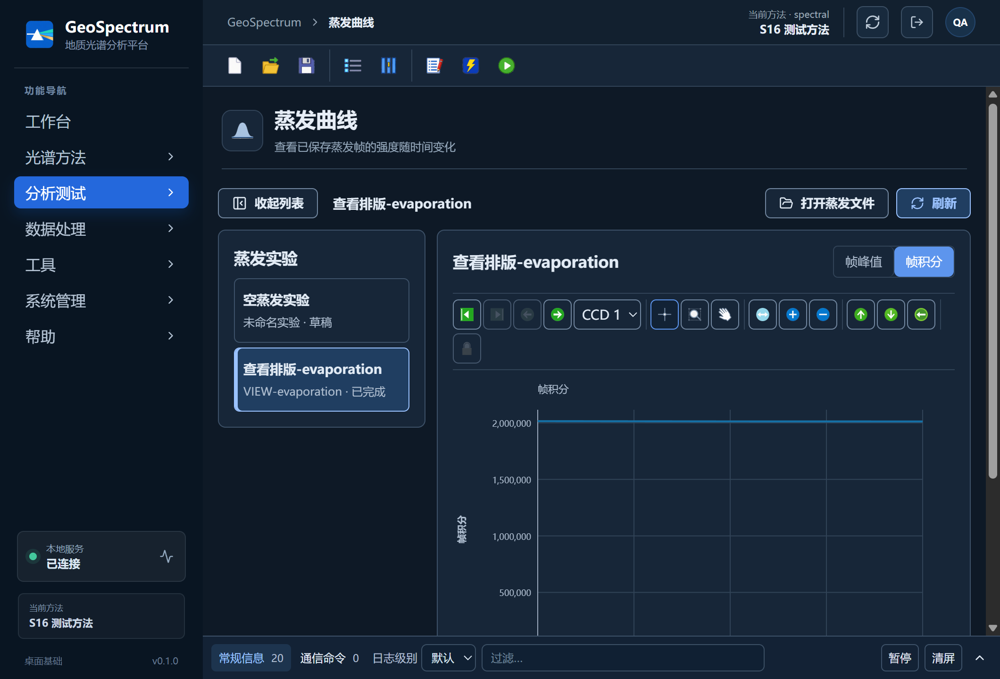
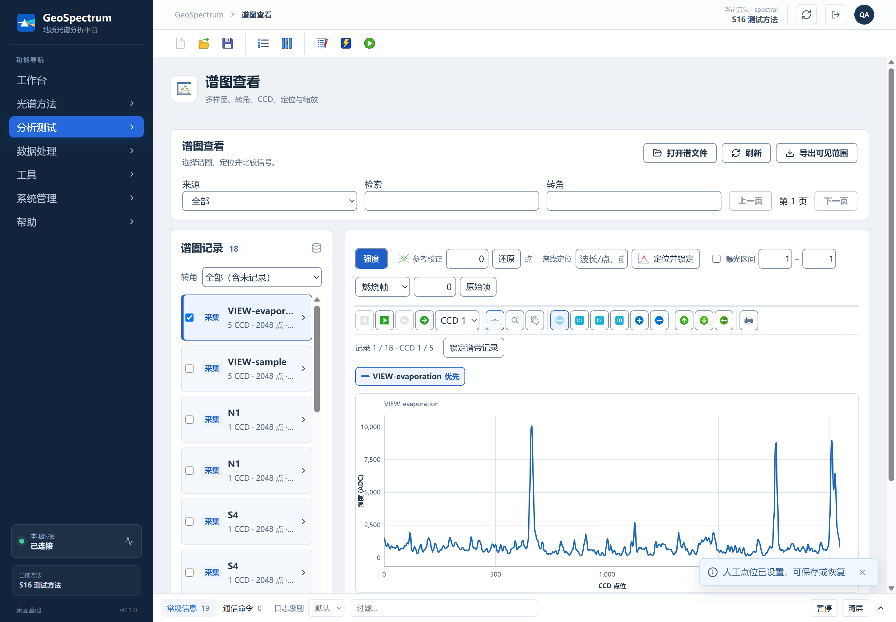

# 三个查看页面的按钮与布局

- 旧源：`Spec Source/Source/Main/mmAnalyze/FmView.dfm:212–393` 的图像工具栏，以及 `394–537` 的谱线操作栏；`FmView.pas:541–552` 按WDT隐藏/显示动作。`FmViewSingle.pas:387–395` 对蒸发数据默认显示分时信息。历史文件保持只读。
- 色散曲线：增/删在选择谱线之前，定位波长和曝光区间相邻，校正/拟合紧跟其后。左选任务，中间显示保存帧/区间均值，CCD、查看、缩放改用高清图标；增线打开下方谱线编辑，版本管理折叠。跨CCD选线同步图像并保留选择，人工点位仍按0起点提交。
- 蒸发曲线：左选实验，中间曲线；上一/下一实验、CCD、十字线/区域/滚动、适合图像、横纵缩放、独立纵向还原依旧版分组排列。峰值/积分使用按钮切换，帧表默认收起。读数来自原保存帧；保留亚秒刻度、单帧点标记，读取失败清空曲线并允许重试。时间曲线不套用CCD物理比例。
- 谱图查看：定位/参考校正/曝光和单帧操作在上，下面是谱带/CCD、十字线/区域/滚动、适合图像/1:1/1:4/十倍、横向、纵向/还原、打印的工具条；原叠加、优先、记录锁、导出、打印设置和详情保留。纵向还原仅还原Y，参考校正另有还原入口。
- 显示：沿用既有256像素高清资源，以16像素显示、28像素点击区域；大小窗口按组换行，保持新版导航、主题和业务权限。图标保留中文悬停/无障碍名称。

验证：浏览器和冻结QA桌面各9组/6布局，采集浏览器回归5组/9布局，前端15项及正式/QA构建通过。桌面PDF通过实际接口生成并在QA保存边界模拟取消，未实测实体出纸。根目录配对程序已更新，关闭旧窗口重开生效；安装包未更新。

本批调整既有查看界面。蒸发页仍使用帧峰值/帧积分统计，不据此宣称已新增旧版逐谱线蒸发计算或硬件等价性。

