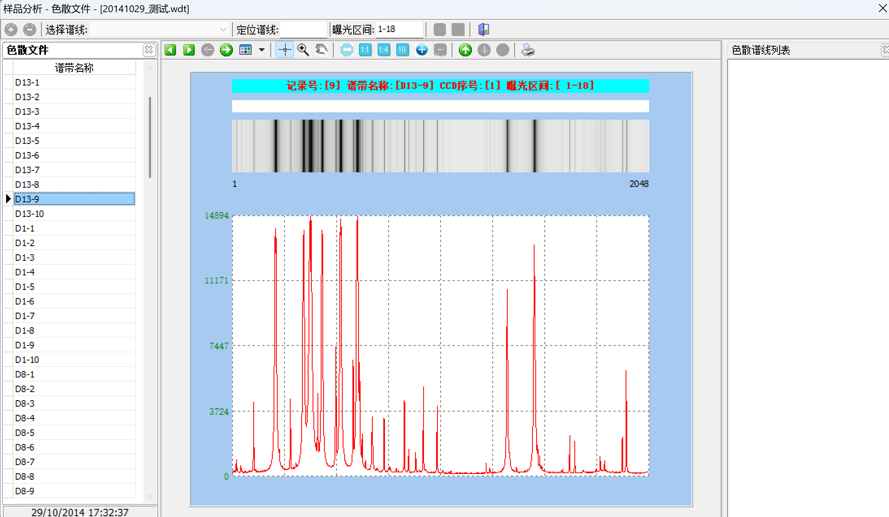
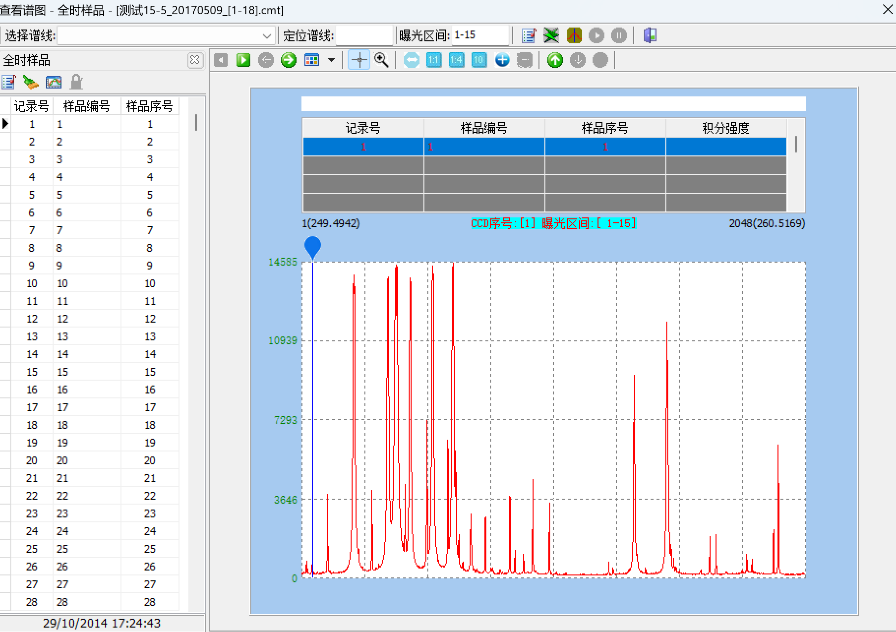
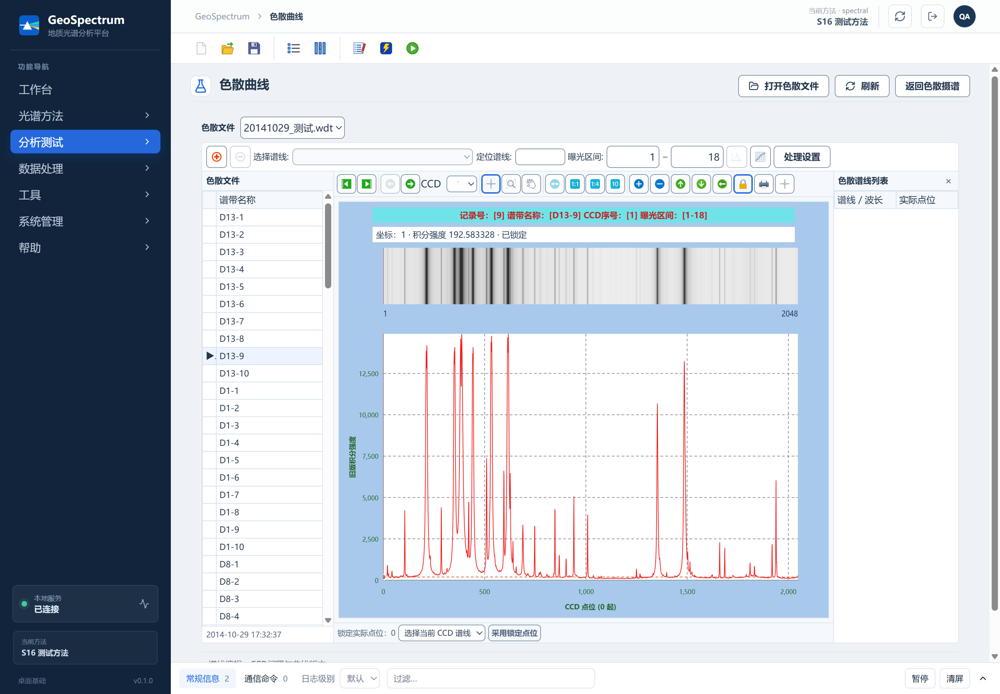
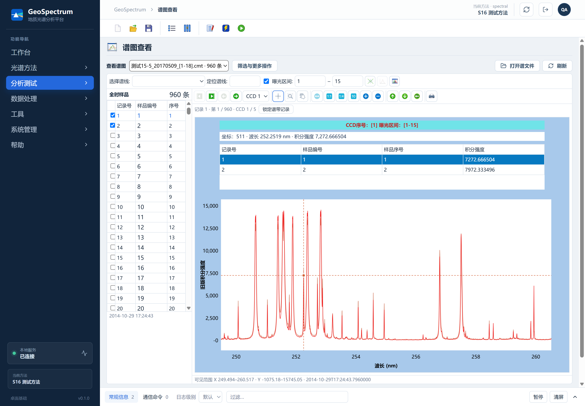
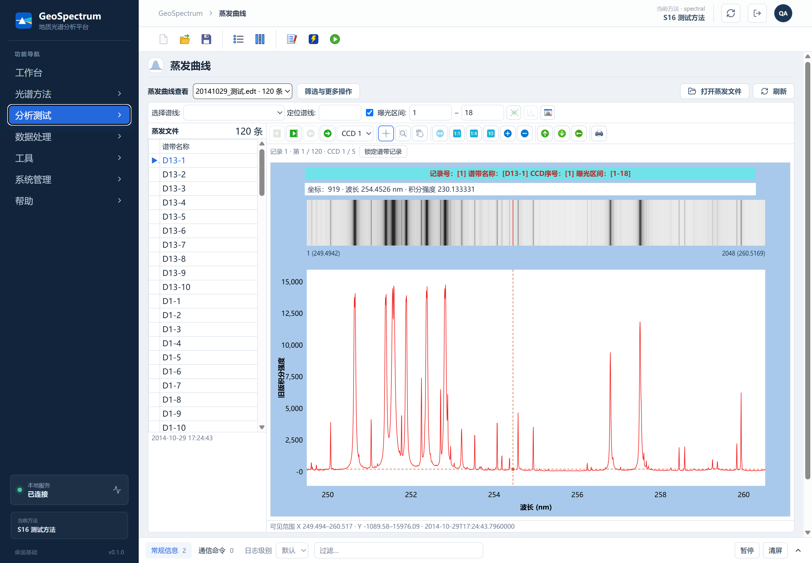
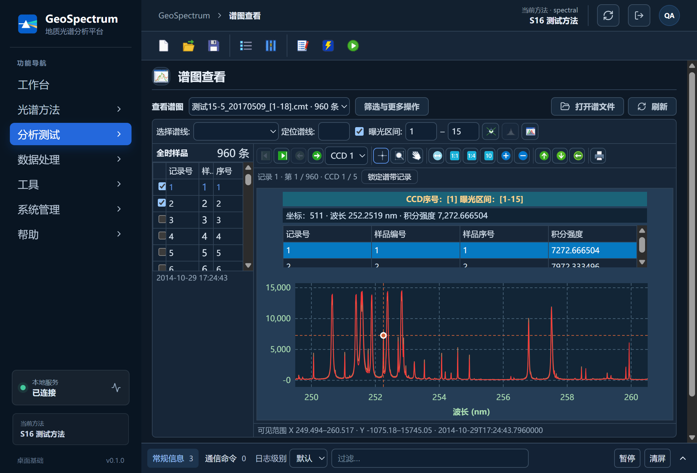

# 旧版曲线与谱图查看结构修正（2026-10-26）

用户提供的两张旧WDT/CMT截图为本批视觉依据。2026-10-25上一批只调整了按钮分组，不能据其验收结论宣称完成了旧版查看区结构复刻。

| 部分 | 本批实现 | 旧源依据 |
|---|---|---|
| 记录层级 | 先选文件，完整列出文件内记录。旧WDT/EDT显示谱带名，CDT/CMT显示记录号、样品编号、样品序号；CCD在记录内部切换 | `FmViewSingle.GetBandSimpleTitle`，`FmViewMulti.DisplaySgPoints` |
| 色散布局 | 顶部增删/选线/定位/曝光操作；左侧色散文件记录；中央图像工具与灰度/峰形；右侧常驻色散谱线列表 | `FmView.dfm:212–393,394–537`、`FmDockGuideLines.dfm` |
| 灰度 | 从同一份真实强度生成；使用平方根对比度、最小绘图最大值5000与Delphi偶数舍入。灰度与峰形共用横轴视野；灰度上读点、拖动、框选同步 | `FmViewSingle.pas:606–628`、`FmView.pas:1386–1403` |
| 全时样品 | 默认显示上方四列表格和下方峰形，鼠标同点读取所选记录的积分强度；可切换单样品灰度视图 | `FmViewMulti.pas:81–105,136–198` |
| 只存原始帧 | CMT/EDT没有均值时，按保存的燃烧帧数启用完整曝光区间，不再打开即空白 | 既有只读区间查询与原始帧校验 |
| 显示强度 | 旧文件显式使用`legacy_2_0_2`：区间燃烧总和/(帧数×燃烧周期)减去暗帧总和/(暗帧数×空白周期)，最小0.1并转Single；单ErrIndex只修补内存副本。CSV/PDF使用同一口径，默认API仍保留原行为 | `uCcdBand.pas:939–974,1080–1137` |
| 谱线定位 | 本机样品从确切已发布方法快照得到CCD/点位；旧文件按自身布局与系数定位。选择谱线同步CCD，观察不改写方法或原始数据 | 方法模块公开快照/几何服务，谱图公开API |
| 蒸发查看 | 主区接入谱带/CCD/灰度/峰形查看；既有各帧峰值、积分统计保留在展开区。无谱图读取权限者保留原采集读取路径 | 旧EDT分时入口与既有帧统计 |
| 大小窗口 | 保留新版主导航；操作区使用紧凑表格和按钮。窄窗口保持左右布局，按信息记录面板的实际位置分配图像高度 | 用户当前布局授权 |

两个分页缺口已修正：色散任务接口原默认只返回50条；谱图列表原默认100条。现在读取全部分页后按原文件记录排序；文件目录独立返回，避免较新的大文件遮住较早文件。本批使用同名真实旧资料：WDT 120条、CMT 960条、EDT 120条。原件只读导入隔离库，保留SHA-256。

术语：旧版列表中的一条“谱带”记录可以含多个CCD的数据，不等于底层一份CCD存储。任务与旧文件记录也不统一称为“谱带”。

本批没有改数据库schema、采集状态机、定量算法或真实设备协议；不把本次查看验证当作真实仪器、实体打印、签名或正式发布验收。

强度显示差异为本批新发现的事实冲突：此前燃烧ADC均值使D13-9峰高约为旧截图的两倍，不能把它当作旧版积分强度。新口径是查看时计算，不写回任何原始帧、均值或分析结果；缺少有效周期或原帧校验失败时明确拒绝该显示请求。

实际桌面首轮发现小窗口的峰形仅剩约50像素高、纵轴刻度重叠。修正为紧凑页头、短窗口灰度和表格缩短、移除色散内层重复留白，并按图高调整纵轴刻度密度。色散重复的底部读数移到“输入点位”按钮窗口，实时读数仍在图上方，人工0点输入与采用点位保持；验收增加峰形净高度至少100像素及刻度不重叠的检查，不以“图框仍在窗口内”替代可读性。

## 用户提供的旧版参考

## 本批实际桌面

实际冻结QA桌面，使用与正式版相同业务源码和前端产物。左为文件内记录；色散右侧保留谱线表，CMT上方显示选中记录同一点的积分强度。截图含两条叠加记录以验证比较功能。

浏览器和实际QA各11组/6布局通过；原有采集流程两侧各5组/9布局通过。详见[验证摘要](verification.json)。

