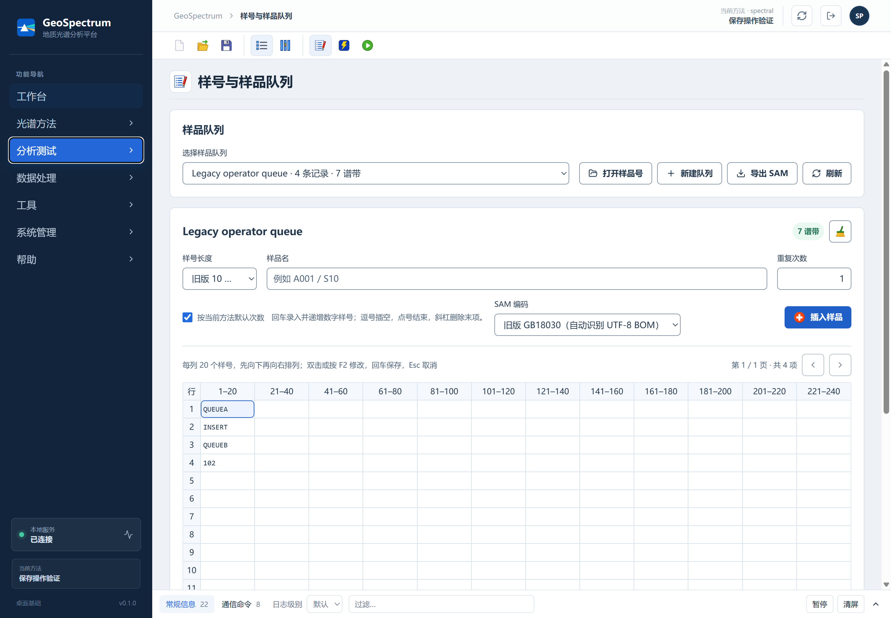

# 其他页面按钮逐项核对

2026-10-31，用户授权“其他页面的按钮也按旧软件逐项核对，有功能不一致的直接修正”。范围为既有 S24，以及关联的样号、分析和输出业务。本批没有进入新的实施步骤。

以旧 Delphi 原件中的窗体、事件和调用链为依据，盘点新版 **418 处按钮／可点击控件声明**、旧版 **357 处控件／动作声明**。这里包含复用组件、菜单和表格选择，不代表 418 个独立业务动作，也不代表逐个完成真实仪器验证。新版逐项清单记录文件、行号、标签、事件、禁用条件和旧源码入口；完整事件正文另表保留。

- [新版逐项清单](按钮逐项清单.json)
- [旧版控件与事件](旧版按钮事件清单.json)
- [验证与交付记录](verification.json)

## 已直接修正

| 操作 | 发现的问题 | 修正后的行为与依据 |
| --- | --- | --- |
| 摄谱窗口“插入样品” | 打开了新建摄谱任务窗口 | 打开当前队列的预录样号表，并把光标定位在当前样品。旧 `FmDockGuideIgnit.pas:141` 调用 `SetSamps(CbNames.ItemIndex)`，并非另建任务。 |
| 样号表“插入样品” | 始终追加到队尾 | 插入当前表格光标之前；回车连续录入仍按此前批准的操作追加、递增。旧 `FmSampInput.pas:134/524` 的插入位置由当前格确定。读取未完成、正在编辑或保存时禁止冲突操作。 |
| 摄谱窗口“清除待测样号” | 只清空当前选择，列表仍保留 | 清除本次待测列表及选择，重新使用样号表可恢复；不删除保存的队列、任务和谱带。旧 `FmDockGuideIgnit.pas:129` 清空待测组合框，本身不是删除历史文件。 |
| 重算来源及旧记录区间“全选” | 再次点击会取消选择 | 重复点击仍全部选中；“反选”独立翻转当前列表。旧 `FmImportPre.pas:302` 明确把每行选择设为 True。 |
| 曲线“全部还原” | 连已停用的标准点也重新启用 | 只恢复原始强度，保留启用／停用状态。旧 `FmAnaCurve.pas:254/1171` 恢复 `CurBlack`，不重置启用标记。新增可选 API 字段 `restore_activation=false`；既有调用省略字段时保持原兼容行为，动作仍审计。 |
| 分析谱图工具 | “适合图像”同时重置纵轴，纵向缺少独立还原，空谱可操作 | “适合图像”只还原横向；纵向以下限为锚缩放并独立还原；无点位禁用；区域放大后回到光标查看。旧 `FmView.pas:344` 仅调用横向适配，`FmViewSingle` 保留独立纵向缩放／还原。 |
| 软件设置“选择目录” | 浏览器目录上传控件仅保留目录名，丢失完整路径 | 桌面调用独立原生目录选择命令，保留中文完整路径；取消不改输入、不自动保存，也不改旧资料来源位置缓存。浏览器模式使用完整路径输入。 |
| 软件设置草稿 | 选择目录后，晚返回的设置读取结果会覆盖未保存值 | 增加草稿保护；服务刷新后新选路径仍保留，保存成功同步草稿，恢复默认仍为明确操作。 |
| 样号表“导出 SAM” | 异步导出失败未提供可靠反馈和操作锁定 | 导出中锁定，失败显示原因并恢复可重试状态；队列不变。 |
| 分析报告“确认” | 可在前一次请求未结束时重复提交 | 请求互斥，确认期间使用既有忙碌门禁，失败恢复可重试；不可变版本与输出限制保留。 |
| 旧结果迁移“打开记录” | 请求失败可能成为未处理异常 | 加入忙碌门禁和失败提示，失败后可重试；只读暂存、校验和原子提交规则保留。 |

最后五项中包含新版平台边界或异常处理；没有把它们误写成旧软件具有完全相同的界面。

## 各页面核对范围

“声明数”是静态清单数量；一处声明可能按数据生成多个按钮。旧软件无对应项的登录、角色、扩展和迁移确认等，按现行授权及权限约束核对。

| 页面／共用区 | 声明数 | 对应旧源码／核对结论 |
| --- | ---: | --- |
| 方法 | 36 | `FmMain`、`FmMtdCfg/Lines/LinesAdd`、`FmSelect/MtdPrint/PageSetup`：新建、打开、保存、另存、重命名、删除、当前方法及谱线编辑；保留发布版本、历史引用、失败草稿和只读权限。 |
| 样号队列 | 14 | `FmSampInput`、`FmDockGuideIgnit`：打开／建立、光标插入、编辑、删除、清空、翻页和 SAM 导出；修正上述插入与导出。 |
| 样品／蒸发摄谱 | 43 | `FmDockGuideIgnit/IgnitCon/View`：试样、预热、暂停／继续、停止、下一样品、插入和清除；仍遵循此前批准的一次点击完成当前摄谱，保留任务和数据安全门禁。 |
| 分析与曲线 | 47 | `FmViewSingle/AnaCheck/AnaCurve/AnaPdt`：分析运行、谱图观察、重复值、标准点、拟合、还原、保存及预览输出；修正强度还原和分析谱图工具。 |
| 色散 | 38 | `FmView/ViewSingle/Wstc`：沿用此前同日批次的真实加减谱线、定位、校正、四线拟合、位置移动保存还原；本批未改写其业务。 |
| 谱图查看 | 51 | `FmView/ViewSingle/ViewMulti/ViewDetail/PrintCcd`：打开、选择、叠加、锁定、详细点位、观察工具及 PDF；只读查看中的录入、测量按钮继续明确禁用。 |
| 重新计算 | 14 | `FmImportPre/Export`：来源、区间、全选／反选、重算、EDT 转换及数据输出；修正两处选择语义，保持原子校验和来源完整性。 |
| 打印与导出 | 8 | `FmPrintDat/Export/PageSetup`：报告建立、预览、确认、Excel/PDF、打印与取消；修正重复确认，保留已批准的分析报告／强度数据两页签。 |
| 设备参数／调试 | 26 | `FmCfgSoftWare/OptHardWare/Debug`：参数保存、连接、开始、停止、断开及三路观察；保留此前按旧版重写的对中逻辑，模拟流程和只读权限回归。 |
| 汞灯校准 | 12 | 旧源码无独立完整校准界面；按现行授权核对新建、启动、应用、回滚、停止及轨迹窗口，模拟会话安全结束。 |
| 自动／手动转角 | 19 | 旧版无当前独立任务及版本界面的直接对应；保留此前批准的方法角度绑定、手动时长、暂停重采与保存规则，不猜测真实协议。 |
| 软件设置 | 3 | 目录按钮按配置／备份用途核对；修正完整路径与草稿保护。主题、维护参数保存及恢复默认保留。 |
| 备份维护 | 6 | `FmMtdBackup`：备份、校验、整理、清理和诊断；保持此前批准的精简界面，本批实际备份及校验在隔离库验证。 |
| 迁移 | 14 | 旧文件的打开／读写实现仅作格式依据；新版暂存、校验、确认是只读迁移流程，补齐打开记录失败处理。 |
| 登录／用户角色 | 9 | 新版安全管理：真实登录、角色复制、用户／角色建立、失败保留输入、只读界面与 API 403 回归；不恢复旧版无权限写入方式。 |
| 扩展 | 1 | 新版模块管理，保留能力与权限门禁，无旧软件同名按钮对应。 |
| 帮助／关于 | 7 | `FmMain`、`FmAbout`：帮助选择和关于返回；保留已批准版权和简化内容。 |
| 工作台 | 4 | `FmMain` 的入口作用对应，保留新版权限过滤和状态信息。 |
| 顶栏／导航／任务布局 | 13 | `FmMain`：快捷入口、返回、展开收起、刷新和退出；检查注册入口及禁用条件，未新增导航分支。 |
| 共用观察／消息／文件组件 | 53 | `FmView`、`FmMessage` 等：缩放、光标、点位、预览、输出、复制、消息过滤／暂停／清屏和来源选择；保留共享组件与调用方权限。 |
| 合计 | **418** | 完整标签、动作与行号见逐项 JSON。 |

## 验证与交付

浏览器和实际冻结 QA 桌面分别完成 **25 个注册入口、37 组功能检查、43 个布局组合**，均无 JavaScript 异常。真实流程覆盖方法保存及失效版本拒绝、光标插入、幂等全选、停用标准点还原、谱图缩放、报告确认、真实 Excel/PDF 内容、输出取消、备份校验、角色权限，以及对中／汞灯模拟启动和安全停止。最小／普通／超宽窗口及明暗主题采用复用回归检查。

后端 68 项、前端 20 项、Rust 5 项通过；TypeScript/Vite、冻结后端和正式／QA Tauri 构建通过。两种构建的产品源码和前端资源完全一致；107 份旧 PAS/DFM 原件散列保持。全部写入测试使用隔离库。

主目录两个 EXE 已配对备份更新，安装包未重建。保留“GeoSpectrum 全页面按钮核对”及所需后端，停在含插入示例的样号表；设备断开，汞灯模拟会话为安全态。此前打开的用户窗口保留，关闭旧窗口重开主目录程序后使用本批版本。

证据中的目录选择／取消验证发生在原生命令返回边界；没有自动操作系统目录对话框。打印取消验证发生在打印边界，没有进行实体打印。真实设备、转角／汞灯协议、签名和正式发布的既有外部门禁保持。

