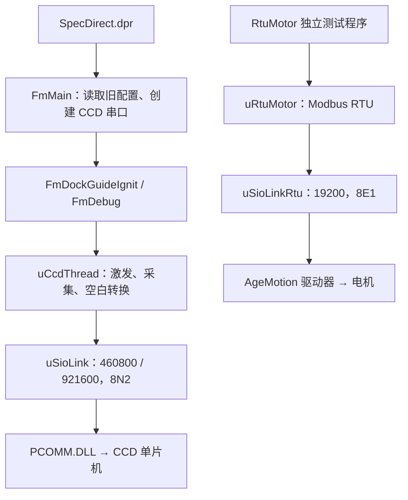

# 电机控制原理与源码依据

本篇合并原来的“电机控制 API 分析与接入说明”和“RtuMotor 完整控制逻辑解析”中的原理、参数及源码依据，去除重复的概述、参数表和接口说明。

**阅读边界：**SpecSource 是旧光谱采集与分析软件，RtuMotor 是独立单轴电机调试程序。以下对旧程序的描述来自源码和离线核查，不能证明它已在交付仪器运行。表中的软件默认值不能代替现场有效配置；新 API 字段和默认限制来自此前实现，实际使用以选定版本的 schema 为准。

现行 GeoSpectrum 接入见 [硬件与电机索引](README.md)，现场待办见 [核对清单](commissioning_checklist.md)。文中的源码和证据路径相对于原研究工作区 `E:/Bocchi/Codes/Code_Lab/地质局项目/`。

## RtuMotor 的功能边界

**RtuMotor 是可以向驱动器发送真实控制指令的单轴电机调试程序。它把操作者输入的角度或位置换算为目标脉冲坐标，通过串口发送 RTU 报文，写入驱动器的目标位置寄存器，再读取驱动器的位置判断运动是否结束。**

它已经包含连接、参数读写、绝对定位、按步数增量移动、坐标重设、坐标偏移置零、反向间隙补偿、停止、状态读取和驱动器保存重启等逻辑。电机产生具体运动所需的驱动输出由驱动器完成，电脑程序不直接生成每个步进脉冲。

它没有光谱采集、波长计算、分析方法、短波优先、关键波段优先或摄谱调度，也没有从光学标定数据求光栅目标角度的功能。对于正式项目，它是电机通信与运动控制的参考实现。

```text
操作者输入目标角度 / 目标位置 / 移动步数
       ↓
FmRtuMotorMain：输入处理、范围检查、运动循环、间隙补偿
       ↓
TRtuAgeMotion：角度换算、寄存器读写、报文编码、CRC
       ↓
TSioLinkCom：打开 COM、设置串口格式、读写字节
       ↓
PCOMM.DLL → 串口连接 → 电机驱动器 → 电机及机械机构
       ↑
     位置、速度、电流和错误码反馈
```

这里的“角度”是软件按每圈脉冲数定义的坐标。源码没有独立的电机—光栅传动比、光学零点或非线性机构换算，不能由此认定输入 45° 就必然对应光栅真实转动 45°。


## 分析覆盖范围与原软件调用链

已对 SpecDirect 的 **64 个 Pascal 单元、42 个 DFM 窗体、1 个 DPR、1 个 DPROJ，共 108 个当前源码/资源文件、37,989 行**建立全量检索索引；另包含 RtuMotor 当前源码及测试和 192 份历史源码备份，总计 316 个条目。索引记录编码、行数、SHA-256 和相关命中。

这指全量文件检索、依赖和通信调用链核查，不表示对 37,989 行做了逐行正确性证明，也没有反编译 EXE/DCU。电机相关通信、配置、运动控制分支已详细阅读；其余分析、绘图、打印模块用于确认功能边界。原研究工程的覆盖表与机器可读证据位于 `evidence/source_coverage_index.md` 和 `evidence/source_scan_index.json`。

已提取旧 CHM 中全部 **42 个 HTML 帮助主题**，并读取 3 份原协议/格式 Word 文档。旧帮助“色散摄谱”说明：同一仪器采用不同光栅转角时要制作不同色散曲线；它没有给出计算机驱动光栅的协议。



重要排除项：

- `uCcdThread.pas:24` 的 `mwStartTurn/mwEndTurn` 和 `wsTurn` 容易被误读为电机转动。看 `:390` 附近，该分支接收过渡数据，之后进入 `wsDark`；界面 `FmDockGuideIgnit.pas:658` 显示“状态转换”。这是激发转空白采集，不写电机寄存器。
- `FmPrintCcd.pas` 的 `FRotate` 是打印旋转方向。
- 色散曲线是 CCD 像素与波长的关系，不能当作“电机角度→波长”的标定关系。
- `PCOMM.PAS` 中列出的波特率常量是通信库的能力，不等于实际选定波特率。

关键原文位置（相对项目根目录）：

| 文件与位置 | 事实 |
|---|---|
| Reference/SpecSource/Source/Main/SpecDirect.dpr:8 | 所有主程序引用；没有引用 uRtuMotor |
| Reference/SpecSource/Source/Main/FmMain.pas:1180 | 用 G_SdOpts 创建 CCD 串口 |
| Reference/SpecSource/Source/Common/uSioLink.pas:147 | CCD 格式 `BIT_8 + STOP_2`，即 8N2 |
| Reference/SpecSource/Source/Common/uCcdThread.pas:232 | CCD 起始帧 F0…F0 |
| Reference/SpecSource/Source/Common/uCcdThread.pas:390 | 激发转空白的过渡状态 |
| Reference/RtuMotor/Source/FmRtuMotorMain.pas:323 | 创建电机对象，使用 `Bauds[1]` |
| Reference/RtuMotor/Source/Common/uSioLinkRtu.pas | Bauds[1]=19200；Open 使用 `BIT_8+STOP_1+P_EVEN` |
| Reference/RtuMotor/Source/Common/uRtuMotor.pas:117 | 站号、功能码和寄存器地址 |
| Reference/RtuMotor/Source/Common/uRtuMotor.pas:316 | 帧编码、读取、CRC、应答处理 |
| Reference/RtuMotor/Source/FmRtuMotorMain.pas:408 | 位移命令、反向间隙补偿、到位/停止逻辑 |


## 检查范围与源码分工

当前文本资料共 **19 个文件、3086 行**，包括主程序及两个辅助测试程序的源码、DFM、工程文件、配置和 CRC 参考文本。另读取并建立了 192 个历史文件的摘要，对五个主要文件与各自最近历史版本进行了差异检查；没有对全部历史版本逐行重复语义审查。二进制和编译产物只建立清单，第三方 DLL 内部实现不在可见源码范围内。

| 文件 | 分工 |
|---|---|
| RtuMotor.dpr（`Reference/RtuMotor/Source/RtuMotor.dpr:1`） | 创建 VCL 窗口、引用各单元 |
| FmRtuMotorMain.pas（`Reference/RtuMotor/Source/FmRtuMotorMain.pas:1`） | 主控制流程，绝大多数操作语义和运动算法在这里 |
| FmRtuMotorMain.dfm（`Reference/RtuMotor/Source/FmRtuMotorMain.dfm:1`） | 控件、初始状态、输入限制及事件绑定 |
| uRtuMotor.pas（`Reference/RtuMotor/Source/Common/uRtuMotor.pas:1`） | TRtuAgeMotion，协议与寄存器访问 |
| uSioLinkRtu.pas（`Reference/RtuMotor/Source/Common/uSioLinkRtu.pas:1`） | 串口抽象、PCOMM 调用和串口错误处理 |
| PCOMM.PAS（`Reference/RtuMotor/Source/Common/PCOMM.PAS:1`） | 第三方串口 DLL 的常量和外部函数声明 |
| uRtuOptions.pas（`Reference/RtuMotor/Source/Common/uRtuOptions.pas:1`） | 读取 EXE 同目录的配置文件及默认常量 |
| RtuMotor.Opt（`Reference/RtuMotor/Bin/RtuMotor.Opt:1`） | 随附配置：COM3，Motor 节为空 |
| TestCrc、RtuEndian | 分别测试 CRC 和字节序，不控制电机 |

完整函数与事件对应关系见 源码与事件索引（`MotorApiResearch/evidence/rtumotor_source_and_event_index.md:1`）。索引中的 160 项含 PCOMM 外部导入声明，不能理解为 160 个电机功能；DFM 共登记 37 个事件绑定。


## 电机连接参数：已知值和确认等级

“源码默认”不等于“真机实测”。本表将二者分开。

| 参数 | 资料中的值 | API 字段 / 开发处理 | 证据与确认等级 |
|---|---|---|---|
| 协议 | Modbus RTU，AgeMotion 寄存器模型 | 固定该协议 | RtuMotor + 手册 §4.2，已确定 |
| 物理接口 | 手册支持 RS485 总线或 USB 控制 | 使用操作系统串口 | 接线、转换器和实际接口待现场确认 |
| 串口 | 默认 COM3；旧界面 COM1～COM16 | `port`，真机必须显式填写 | RtuMotor.Opt、uRtuOptions.Load；默认值 |
| 波特率 | **19200** | `baud_rate` 默认 19200 | FormCreate 使用 Bauds[1]，已确定测试程序取值 |
| 支持的测试波特率 | 9600/19200/38400/57600/115200 | 枚举校验 | uSioLinkRtu.Bauds |
| 数据/校验/停止位 | **8E1** | 固定 8、Even、1 | 串口 Open、手册 §4.2.1 |
| 流控制 | 旧封装未设置 | 新实现显式关闭软件/RTSCTS/DSRDTR 流控 | 实际转换器是否自动切换 RS485 收发待确认 |
| 从站地址 | **1** | `address` 允许 1～247；禁广播 | DefRtuAdr=$01；手册 §4.2.3 |
| 单次读应答超时 | **200 ms** | `response_timeout_s=0.2` | OutIn 传入 200，优先于封装默认 100 |
| 事务间隔 | **30 ms** | 真机默认保留 0.03s | OutIn 末尾 Sleep(30) |
| 写入超时 | 原电机链路没有明确设置 | 新实现等于 response_timeout_s | 新增边界，不是旧设备参数 |
| 帧间静默 | 至少 3.5 字符时间 | 上述 30ms 已覆盖支持波特率 | Modbus 串行规范；19200、11bit/字符约 2.005ms |
| 数据端序 | 地址和整个数值高字节先；CRC 低字节先 | 32/64 位整体 big-endian | SwapEndian + Word2Buf，手册 §4.2 |
| 轮询周期 | Delphi TTimer 没有显式 Interval，运动内部循环逐次读 | 新 API 默认 0.1s，另加每次通信耗时 | 新设计值，不是实测运动周期 |
| 运动/停止超时 | 原运动循环没有总截止时间 | 新增 30s / 3s 默认值 | 新软件保护参数，现场需调整 |
| 到位后稳定时间 | 原代码未实现 | 新增 0.2s 默认值 | 新软件参数，不能代替光学稳定时间实测 |

**CCD 串口不同：**`DIRECT.OPT` 是 COM3、460800，`uSioLink` 支持 460800/921600 且用 **8N2**；协议文档写 RS232。CCD 与电机都出现 COM3，只是各自历史默认，不能在同一 COM 口同时按这两种协议通信。新电机配置与 `device_profiles` 的 CCD 配置独立。

串行规范的 CRC 和帧间隔亦核对了 [Modbus 官方串行规范 V1.02](https://www.modbus.org/docs/Modbus_over_serial_line_V1_02.pdf)。设备特有寄存器仍以本地厂商手册和 RtuMotor 为准。


## 机械、角度、电流、速度参数

### 原程序默认值

| 参数 | 默认值 / 范围 | 单位与意义 |
|---|---|---|
| TResolution | 76800 | 每机械齿的最小细分单位 MMS；可读 0x0028 |
| Teeths | **100** | 电机齿数，源于 uRtuOptions.DefTeeths；不是传动比 |
| MmsPerTurn | 7,680,000 | 76800×100，电机轴每圈 MMS |
| StepPerTurn / PulsePerTurn | **640000** | 原程序用于每圈角度换算的脉冲数；旧Load断言≥128000且整除MmsPerTurn |
| PulseLength | **12（计算值）** | 7,680,000÷640,000；真机 0x002A 读回才算确认 |
| CurrentSet | 默认100；界面20～100 | 每单位0.01A，默认**相电流峰值1.00A**，不是有效值 |
| CurrentLow | 默认50；界面30～100 | 保持/降流电流占工作电流百分比 |
| VelSet | 默认640；界面200～1000 | 速度寄存器原始值；在100齿、KV=20假设下默认100rpm |
| VelStart | 默认16；界面5～50 | 起跳速度原始值；旧注释默认2.5rpm |
| 角度区间 | 默认0～90° | 实际由 CheckPulse 限制0～PulsePerTurn/4；“不限转角”菜单可绕过旧限制 |
| 反向间隙 | 初始0；界面上限3200脉冲 | 在640000脉冲/圈、直连假设下3200=1.8°，不是实测间隙 |

**很关键：**随包 `Reference/RtuMotor/Bin/RtuMotor.Opt` 的 `[Motor]` 节是空的。Load 会读出上述软件默认值，但 FormCreate 只把 MmsPerTurn、PulsePerTurn 赋给对象；连接后的 `GetRtuSet` 从驱动器读取电流、速度、PulseLength。没有把这些默认电流/速度/PulseLength 自动写入驱动器。`TRtuOpt.Save` 也是空实现。不能说“真机当前就是1A、100rpm、12MMS/脉冲”。

手册大部分算例使用 **50齿**，测试软件使用 **100齿**。不能照抄手册的简化算式当作本机配置。

### 换算公式

旧测试程序直接采用：

```text
脉冲目标 = round(角度 × 640000 / 360)
角度 = 脉冲位置 × 360 / 640000
MMS目标 = 脉冲目标 × PulseLength
```

在这个默认前提下：1脉冲=0.0005625°，45°=80000脉冲，90°=160000脉冲；90°对应1,920,000 MMS。**这只是数字分辨率，不是系统定位精度、重复性或光谱分辨率。**

新 API 显式区分光栅角度与电机轴角度：

```text
P = 电机轴一圈脉冲数 pulses_per_motor_rev
G = 电机转数 / 光栅转数 gear_ratio
D = direction，取 +1 或 -1
Z = 0°光栅角对应的驱动器脉冲坐标 zero_pulse

pulse = Z + round_away_from_zero(angle_deg × P × G × D / 360)
angle_deg = (pulse - Z) × 360 / (P × G × D)
PulseLength = TResolution × motor_teeth / P
```

`gear_ratio=1` 只是与旧测试换算一致的初始假设；没有资料证明现场光栅与电机1:1直连。如果机构不是线性传动，还需实际标定函数，不能仅靠传动比建模。

原 Delphi 的 `Trunc(D+0.5)` 对负数有偏差，例如 −90°变成 −159999脉冲；新实现已改为对称取整，溢出直接报错，禁止静默截断。

### 速度公式的适用范围

厂商手册 §4.4.21：

```text
设定速度 rpm = VelSet × KV × 60000 / (TResolution × 电机齿数)
```

在76800、100齿、KV=20条件下：rpm=VelSet×5/32，640→100rpm。KV可读0x0043；机械齿数需确认。

**实时速度 Vel 的单位存在需要核对的差异：**手册 §4.4.26 直接列出 `rpm=Vel×5/16`，而测试软件只是显示有符号原始 Vel，并没有进行100齿换算。新 API 返回 `velocity` 原始值，只用其是否为0辅助判断静止，暂不输出未经确认的实际 rpm。VelStart 也应按对应型号手册/实测核对。


### 调试参数默认锁住

DFM 将四个参数输入框初始设为不可编辑。Ctrl+Alt+W（`Reference/RtuMotor/Source/FmRtuMotorMain.pas:352`） 会解锁并显示重启按钮。这是调试快捷键，不是正式的用户权限系统。

修改参数并离开输入框后，检查界面范围，再写对应寄存器。写入成功后更新对象缓存；没有独立读取同一参数再次核对。

手册中运行速度换算涉及 KV、每齿分辨率和电机齿数。源码注释的“640 对应 100 rpm”依赖其假定条件，不能不加条件地用于其他驱动器配置。实时速度字段也只是直接显示寄存器整数。协议原文见 速度参数说明（`MotorApiResearch/evidence/ExtractedText/CtrlAndCom_CHN.txt:2150`）。


## 完整协议参数与寄存器

地址均为**报文中的零起始十六进制地址**，不要把 PLC 的40001等编号直接写进帧。

| 操作 | 功能码 | 数值宽度 | 请求/正常响应长度 |
|---|---|---|---|
| 读16位 | 0x04 | 1 word | 8 / 7字节 |
| 读32位 | 0x03 | 2 words | 8 / 9字节 |
| 读64位 | 0x03 | 4 words | 8 / 13字节 |
| 写16位 | 0x06 | 1 word | 8 / 8字节 |
| 写32位 | 0x10 | 2 words | 13 / 8字节 |
| 写64位 | 0x10 | 4 words | 17 / 8字节 |

手册 §4.3 规定每次只操作**一个逻辑寄存器**。不能用一次03读取0x0012～0x0015，把四个独立参数当成一个64位参数批读。

CRC16初值0xFFFF，多项式0xA001，覆盖地址/功能码/数据、不包含CRC自身。异常响应5字节，功能码为请求功能码 OR 0x80，异常码01功能码错、02地址错、03数量错。手册某处把06异常写为46，与“+80”规则矛盾；应为86，新代码按规则处理。

### 电机开发直接使用的寄存器

| 地址 | 名称 | 类型 | 用途 / 注意 |
|---|---|---|---|
| 0x0000 | Control | uint16 | 控制字，见下表 |
| 0x0002 | ErrorCode | uint16，只读 | 故障编码，0正常；不是位掩码 |
| 0x0008 | InputType | uint16 | 低4位输入模式，bit13通讯方向，bit15初始脱机；不自动改写 |
| 0x0010 / 0x0011 | CurrentMax / CurrentMin | uint16，只读 | 当前驱动器电流能力；与软件范围取交集 |
| 0x0012 | CurrentSet | uint16 | 相电流峰值，0.01A/单位 |
| 0x0013 | CurrentLow | uint16 | 降流30～100%，默认50 |
| 0x0014 | CurrentLowWT | uint16 | 降流等待毫秒；RtuMotor只声明地址，无公开读写方法 |
| 0x0015 | Current | uint16，只读 | 实时相电流峰值，0.01A/单位 |
| 0x0020～23 | Position | int64 | 实时位置，MMS；写入是重建坐标，非运动 |
| 0x0024～27 | PositionSet | int64 | 目标位置，MMS；写入触发定位 |
| 0x0028～29 | TResolution | uint32，只读 | 单齿分辨率 |
| 0x002A～2B | PulseLength | **uint32** | 单脉冲MMS长度；手册范围1～3840000；旧代码用Int32存储 |
| 0x002C～2D | PulsePosition | int32 | 当前脉冲坐标；写入改变坐标 |
| 0x002E～2F | PulsePositionSet | int32 | **写入即触发运动**，取值−2147483648～2147483647 |
| 0x0040 | VelSet | uint16 | 手册1～38400；当前API采用测试软件200～1000范围 |
| 0x0041 | VelStart | uint16 | 手册1～192；当前API采用测试软件5～50范围 |
| 0x0043 | KV | uint16，只读 | 速度换算系数 |
| 0x0044 | VelFilterCom | uint16 | 总线/USB加减速滤波0～31；不是直接的°/s² |
| 0x0045 | Vel | int16，只读 | 实时速度原始值，负数反向 |
| 0x0060 | BusWDT | uint16 | 毫秒；≥32768关闭；否则通信中断后自动暂停，收到总线指令可能自动继续 |

控制字（RtuMotor实际实现）：

| 动作 | 写入Control的值 | 真实含义 |
|---|---|---|
| Enable | 0x0000 | 使能/取消暂停；可能恢复旧目标，须先核对静止与目标 |
| Free | 0x0004 | 脱机，输出电流为0；须静止再用 |
| Pause | 0x0008 | 暂停，保留原目标，恢复后继续 |
| Stop | 0x1000 | 按通讯滤波设定减速停止并覆盖原目标；不等于切断动力的硬急停 |
| Reset | 0x0001 | **保存参数并重启**，不是机械回零；厂商限制使用频率 |
| RestartFlag | 0x0080 | 重启检测标志；上电后为0，由上位机设置以监测重启 |
| OffsetToZero | 0x0100 | 把目标位置偏移到0，联动改变当前坐标；运动中执行不会主动停下 |

手册还提供MovePSL=0x0010、MovePSH=0x0020、编码器零点等功能。但限位输入、有效电平、方向、编码器是否存在均未知，当前HTTP接口没有开放这些寻零命令。恢复出厂值0x0002也没有开放。

**完整的51个逻辑寄存器映射**（包括端口、看门狗、伺服误差、型号/序列号、温度等）见 [register_reference.md](register_reference.md) 和后端 `motor_protocol.py:REGISTERS`。映射存在不代表全部开放为HTTP写接口；尤其铭牌、序列号、地址、波特率、复位等不应作为普通运动参数。

ErrorCode常见值：0201欠压、0202过压、0203低温报警、0204高温、020F电机开路、0211/0212相开路、0216制动超时、0217位差超限、0218位差超时、030F过流、0411编码器错误；0116为记忆数据丢失。完整错误表见手册 §4.4.2（PDF第24～25页）。未知代码保留原始值，不伪装成无故障。当前API对任意非零值停止运动流程。

### 可用于抓包比对的报文

```text
读 ErrorCode:          01 04 00 02 00 01 90 0A
读 Position (64位):    01 03 00 20 00 04 45 C3
写 Enable:             01 06 00 00 00 00 89 CA
写 Pause:              01 06 00 00 00 08 88 0C
写目标脉冲 10000:      01 10 00 2E 00 02 04 00 00 27 10 6A 07
上述写入正常应答:      01 10 00 2E 00 02 21 C1
```

源码实现可直接生成其他目标的完整帧；切勿把“收到写指令应答”当作“电机已经到位”。


## 从启动到连接成功

### 打开程序不会立即打开串口

FormCreate（`Reference/RtuMotor/Source/FmRtuMotorMain.pas:323`） 的工作是：

1. 读取配置，列出 COM1～COM16，按配置选择串口。
2. 初始化界面和反向间隙值 0。
3. 创建串口对象，指定波特率 19200。
4. 创建电机对象，设置软件侧的每圈 MMS 数及每圈脉冲数。

这里没有执行打开端口、硬件使能或下发电流/速度参数。`EnableRtu`、`DisableRtu` 名字容易误导：它们是界面启用/禁用函数，不是驱动器的使能/失能指令。

### 选择串口才开始通信

CobPortClick（`Reference/RtuMotor/Source/FmRtuMotorMain.pas:236`） 依次执行：关闭轮询定时器 → 关闭旧端口 → 设置所选 COM → 打开与清理缓冲 → 等待 → 读错误码 → 读设置参数 → 读实时状态 → 读两套位置 → 启用界面与轮询。

串口实现见 TSioLinkCom.Open（`Reference/RtuMotor/Source/Common/uSioLinkRtu.pas:140`）。代码只体现 COM 串口，不足以判断现场采用原生串口、USB 转串口还是 USB 转 RS485，也不提供现场接线图。

连接时会读取电流设定、降流比例、运行速度、启动速度、PulseLength、错误码、实时电流、实时速度、脉冲当前位置/目标位置及 64 位当前位置/目标位置。正常路径为 13 笔读交易。**这说明旧程序的重要做法是读取驱动器已有设置，启动时并不把所有软件默认值写进去。**


## 界面每个动作的真实含义

| 界面操作 | 处理函数 | 实际动作 |
|---|---|---|
| 选择串口 | CobPortClick | 打开端口，读取驱动器设置及状态 |
| 修改“目标转角” | LeTurnSetExit | 角度换算成脉冲，检查范围，执行定位 |
| 修改“目标位置” | LeTurnSetExit | 直接以脉冲坐标执行定位 |
| 左/右按钮 | BbtLeftClick | 以缓存当前位置减/加“移动步数”，再执行绝对定位 |
| 修改“当前转角/当前位置” | LeTurnExit → SetPulsePos | 暂停，重写当前位置与目标位置，再使能；用于重新定义坐标 |
| “位置置零” | BtnOffsetToZeroClick | 执行驱动器坐标偏移指令，再刷新位置 |
| P 按钮，代码名 BbtPause | BbtPauseClick | 先置 FStopping 标记；运动循环随后执行 Stop |
| 修改反向间隙 | LePulseGapExit | 更新程序内间隙脉冲数，不直接写驱动器补偿寄存器 |
| 启用间隙补偿菜单 | MiPulseGap | 改变 GotoPulsePos 是否插入补偿运动 |
| 自由转动菜单 | MiFreeTurn | 绕过软件 0～90° 检查，不是驱动器 Free 指令 |
| 定时读取菜单 | MiTimerRTu | 控制定时读取错误码、电流和速度 |
| 时间记录菜单 | MiLogTime | 记录程序测得的开始/结束时间，不是完整报文持久日志 |
| 重启按钮 | BtnResetClick | 发送保存重启指令，不等待 RTU 回包 |
| 退出 | BtnOkClick | 关闭窗口；没有显式的先停机并确认流程 |

**目标输入框的动作绑定在 OnExit：值修改后离开输入框就可能触发运动。**“当前”字段则用于修改坐标，不能把它当成另一种目标输入框。左/右操作是一次离散位置移动，没有实现“按住持续转、松开即停”的连续点动。

角度显示保留两位小数，仅是显示格式，不代表硬件只有 0.01° 分辨率，也不代表定位精度达到 0.01°。


## 真正的运动循环

核心是 GotoPulsePos（`Reference/RtuMotor/Source/FmRtuMotorMain.pas:408`），其流程可以整理为：

```text
显示目标
如果缓存的脉冲当前位置等于目标：直接返回

如果是向小坐标运动，且启用了非零间隙补偿：
    第一段目标 = 最终目标 - 间隙
否则：
    第一段目标 = 最终目标

关闭空闲定时器，标记正在运动，禁用部分控件
写入第一段目标 PulsePositionSet
读取驱动器 PositionSet（MMS）

循环，直到收到停止标记：
    处理界面消息
    读取 Position（MMS）
    如果 Position == PositionSet：
        如尚需补偿回程：写最终目标、读取 PositionSet、继续循环
        否则结束
    显示位置，读取错误码、电流、速度

如收到停止标记且当前位置不等于目标：
    发送 ControlStop
    重复读位置，直到连续两次位置相同

刷新脉冲位置与实时状态，恢复界面和空闲定时器
```

### 间隙补偿由电脑安排两次定位

例如当前位置 5000，目标 3000，间隙 200：先去 2800，再正向到 3000。这样最后一段保持同一方向接近目标，意图减小反向传动间隙影响。向大坐标运动时不插入这段补偿。

它不计算间隙，也不自动测量间隙；输入多少就使用多少。补偿策略是否适合交付仪器，要用实际机构验证。

### “到位”究竟证明了什么

正常运动只判断驱动器的 `Position == PositionSet`，没有另外要求速度为零、保持稳定一段时间、光学信号稳定或达到光栅编码器角度。并且比较的是驱动器读回的目标，没有再核对它是否对应本次请求的期望目标。

手册说明开环位置是模拟/推算位置，闭环位置来自反馈。因此这个比较能作为旧程序的运动结束判据，但不能单独证明没有失步、没有机械松动或光栅实际定位精度已达标。参见 位置定义（`MotorApiResearch/evidence/ExtractedText/CtrlAndCom_CHN.txt:1794`）。


## 停止、暂停、释放、设零不是同一个操作

所有下列命令都通过 0x0000 控制寄存器发送，原类封装了七种方法：控制方法（`Reference/RtuMotor/Source/Common/uRtuMotor.pas:157`）。

| 方法 | 写入值 | 语义及本程序用法 |
|---|---:|---|
| ControlEnable | 0x0000 | 清除控制位、使能；用于重设当前位置流程末尾 |
| ControlReset | 0x0001 | 驱动器保存参数并重启；调试重启按钮调用 |
| ControlFree | 0x0004 | 释放输出；主界面没有调用 |
| ControlPause | 0x0008 | 暂停，保留目标；用于重设当前位置前，并非 P 按钮直接调用 |
| ControlRestartFlag | 0x0080 | 设置重启检测标志；主程序没有完成设置、轮询和失效处理流程 |
| ControlOffsetToZero | 0x0100 | 将目标位置平移至零、当前位置同量平移；置零按钮调用 |
| ControlStop | 0x1000 | 停止运动并处理目标；P 按钮触发的运动循环调用 |

暂停保留目标，停止不等同于保留原任务等待恢复，释放则涉及电机输出。不能把代码名字 `BbtPause` 直接翻译成产品“暂停/继续”API。

“位置置零”也不是寻找原点传感器。手册举例：运动中目标 150、当前 90，执行 OffsetToZero 后变为目标 0、当前 -60，原运动不因此停止。只有已经停稳且当前位置等于目标时，两者一起变成 0。参见 OffsetToZero 原文（`MotorApiResearch/evidence/ExtractedText/CtrlAndCom_CHN.txt:913`）。

编辑“当前位置”的另一条路径是 `Pause → 写当前位置 → 写相同目标位置 → Enable`，用于重新定义坐标，也没有寻找机械或光学原点。

重启按钮设置 `OutOnly=True`，发命令后直接显示“已重启”提示。源码没有用回包或重连读回确认重启成功，也没有在重启后完整重新读取所有配置与位置。停止命令受驱动器的运动控制设置影响，不能把它当作硬件急停。


### 用 45° 把整条链连起来

假设软件 PulsePerTurn=640000，目标 45°，无需间隙补偿，则目标脉冲=80000，十六进制为 0x00013880。写 0x002E 的报文为：

```text
01 10 00 2E 00 02 04 00 01 38 80 33 9B
│  │  └地址┘ └数量┘ │  └─目标数据─┘ └CRC┘
│  │               └ 4 个数据字节
│  └ 功能码：写多个 16 位寄存器
└ 站号 1
```

驱动器接受写入后，程序读取 0x0024 的 64 位目标、不断读取 0x0020 的 64 位当前位置，按第 7 节结束运动。这里 45° 是演示计算，不是建议向未知状态真机直接发送的目标。

另外几个离线核对过的报文：

```text
读错误码：   01 04 00 02 00 01 90 0A
读64位位置： 01 03 00 20 00 04 45 C3
使能：       01 06 00 00 00 00 89 CA
暂停：       01 06 00 00 00 08 88 0C
目标10000：  01 10 00 2E 00 02 04 00 00 27 10 6A 07
```

这些是从协议离线计算/核对的字节，不是实际串口抓包。

### 接收与异常处理的实际强度

每次交易调用一次串口 Write，再调用一次 Read 读取期望长度，读取超时为 200 ms。应用层没有循环拼接分段回包；PCOMM 内部如何等待或聚合字节，不能从导入声明推断。

无应答、CRC 错、异常长度或 5 字节异常响应会进入协议错误处理，关闭串口并抛异常。普通成功交易后 Sleep(30)。没有自动重发；OutOnly 模式在写完后直接返回，连这个延时也会跳过。

CRC 有显式运行时校验，但站号、功能码、读取字节数、写响应地址等多处检查只用 Assert。断言是否启用取决于编译配置，不能当作稳定的产品校验。写响应没有完整比较回显的写入值或寄存器数量，即使断言启用也不完整。串口写函数只检查负错误码，不确认正返回值是否等于请求字节数。


## 定时器、错误处理和退出

空闲轮询只调用 GetRtuReal，读取错误码、电流、速度，**不会定期刷新脉冲位置或 64 位位置**。DFM 未显式给出定时器 Interval，代码也未设置，本报告不将某个默认周期当成项目设计参数。

运动开始关闭此定时器，由运动循环自行读位置和状态。循环是同步运行的，通过 `Application.ProcessMessages` 使界面仍可处理点击，并不是独立运动线程或完整任务调度器。

驱动器错误码非零时，GetRtuReal 停止定时器、禁用界面并弹窗，然后返回；它没有抛出运动失败，也没有设置停止标记。所以故障被看见不等于运动循环已经退出。

通信异常经外层 ProcessError 显示并禁用界面，运动主体没有统一的 finally 清理和确定的停止确认。退出窗口的析构只释放对象，没有先发 Stop 并确认，也没有在串口类析构中显式 Close 的实现。

不能用“关闭软件/停止轮询”替代明确停止。手册规定，总线看门狗只有配置为启用才会因通信中断自动暂停，并且收到总线指令又可恢复；旧程序不读取或配置该参数。参见 BusWDT（`MotorApiResearch/evidence/ExtractedText/CtrlAndCom_CHN.txt:2428`）。


## 静态检查发现的具体问题

以下区分可以由代码确定的问题与需要现场验证的效果；没有将静态分析当成已发生的真机事故。

| 问题 | 代码依据/可复现条件 | 移植为 API 时的处理 |
|---|---|---|
| 负角度取整错误 | Degree2Pulse 使用 Trunc(D+0.5)；默认值下 -90° 得 -159999，而精确值应为 -160000 | 使用对正负一致的量化规则；正常 0～90° 路径不受这个负值例子影响 |
| 超大角度被静默截断 | 同函数先钳制到 Int32 范围 | 先验证范围，拒绝不能表示的请求 |
| 增量移动基于旧位置 | BbtLeftClick 使用缓存；空闲定时器不更新位置 | 每次增量命令先读取位置；早退判断也应依据新状态 |
| 间隙中间目标未限位 | 目标100、间隙3200、当前1000时，合法终点会生成 -3100 中间目标 | 校验整段路径，不只最终目标 |
| 停止后仍可能发出补偿第二段 | ProcessMessages 设置 FStopping 后，本轮仍可进入到位分支再写最终目标 | 在任何新目标写入前重新检查取消状态 |
| 运动或停机等待无总超时 | 两个 while 循环都没有整体截止时间 | 为运动、停止分别设超时和失败状态 |
| 故障码没有终止运动流程 | GetRtuReal 只禁用界面、弹窗和返回 | 故障要传递到运动任务并结束正常推进 |
| 到位判据不够用于摄谱联动 | 只比较驱动器位置与读回目标 | 核对请求目标，再结合速度、稳定时间及采集模块约定 |
| 停止确认太弱 | 连续两次位置相同即结束，没有时间窗口或速度条件 | 区分已发停止、停止已确认、无法确认 |
| 通信响应检查不完整 | Assert 校验与不完整写回显检查 | 显式校验完整响应，处理分段数据和异常码 |
| 写入可能不完整却未识别 | TSioLinkCom.Write 不检查正返回字节数 | 确认全部字节已写或报告失败 |
| 异常/退出缺少统一收尾 | GotoPulsePos 无 finally；FormDestroy 无停机确认 | 明确连接与任务生命周期；保留失败信息 |
| UI 重入范围过大 | 运动循环处理消息，但串口选择、退出等没有统一锁住 | 使用单轴互斥和任务状态，禁止连接与运动并发冲突 |
| 配置与硬件比例未核对 | 软件每圈脉冲数与驱动器 PulseLength 分别取得 | 建立一致的单位换算，核对沿用的有效配置 |
| 重启成功提示没有验证 | OutOnly 后直接弹出“已重启” | 等待恢复、重新读设置与位置，确认状态 |

此外，类里的 FReady 没有形成有效就绪状态机；部分整数在校验前已转换为较窄类型；输入框长度/数字过滤只是界面限制，不能替代 API 参数校验。上述问题不否定其协议参考价值，但说明不能把整个 UI 循环原样搬成产品服务。


## 两个辅助测试程序与工程现状

**RtuMotor 主程序是真实串口控制程序；TestCrc 和 RtuEndian 才是纯计算测试。**

| 测试 | 实际做什么 | 没有验证什么 |
|---|---|---|
| TestCrc | 将输入的十六进制字节交给 CRC 函数，显示校验码 | 不验证串口、驱动器响应、电机运动 |
| RtuEndian / RTU转换测试 | 将整数转换成字节并检查大端排列 | 不验证硬件、角度准确性或到位 |

CRC 测试仍引用旧的 `uRtuAgeMotion` 名称及对应全局对象，而当前活动单元是 `uRtuMotor`；当前 CRC 方法又是 private，不能认定现存测试工程直接可以编译。测试中的固定输入缓冲区也没有完整的输入长度保护。

工程组指向 `..\Test\TestCrc.dproj`，实际文件在 `Test\TestCrc\TestCrc.dproj`。主工程部分 Win32 Release 输出路径写死为 `E:\RtuMotor\Bin`、`E:\RtuMotor\Dcu`，迁移构建时要调整。PCOMM 是 Windows DLL 接口，不能因 dproj 模板中存在其他平台项就认为程序可跨平台运行。

当前主要文件与最近备份相比有五处简短变化：间隙上限 2048→3200；目标位置控件位置调整；成功交易等待 50→30 ms；串口初始化增加 100 ms 等待；每圈脉冲数断言下限 12800→128000。差异原文在源码索引末尾。它们不构成真机验证记录。


## 本次离线验证及复核方法

新增 audit_rtumotor.py（`MotorApiResearch/tools/audit_rtumotor.py:1`） 只读取原文件、做离线计算并生成研究资料，不打开串口或加载驱动 DLL。

- 从 Pascal 源码实际提取两张 CRC 表，与附带 C 参考表核对一致；将其算法与独立位运算实现进行 **1258 组输入交叉检查**，包括空输入、标准字符串、全部单字节及固定种子的随机输入。
- 核对 **5 个已知完整报文**，另计算默认 45° 目标报文；标准字符串 `123456789` 的 CRC 为 0x4B37。
- 检查 **15 组 16/32/64 位正负数边界字节序**。
- 离线重现负角度取整、补偿路径越界的反例；用忠实于原分支顺序的模型演示补偿段间停止标记仍可能导致第二次目标写入。
- 生成文件摘要、函数/事件索引、工程失效引用和最近备份差异。

结果见 核查证据 JSON（`MotorApiResearch/evidence/rtumotor_audit_evidence.json:1`）。这些是源码算法的交叉核验，不是 Delphi 编译测试、EXE 运行测试或真机验收。

可在项目根目录用 Python 标准库运行 `python MotorApiResearch/tools/audit_rtumotor.py` 重建证据及索引。本次没有修改原 RtuMotor 源码、配置、EXE 或正式项目业务代码。
