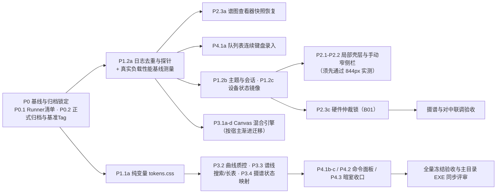

# GeoSpectrum 前端架构与交互深度改进计划

**文档版本**：**v3（双轮源码实证评审定稿版）**  
**文档日期**：2026-11-25  
**适用范围**：`app/frontend/`（React 19 + TypeScript 5.6 + Vite 6 + Tauri 2 Windows 桌面应用）  
**代码基线**：`main` 分支 `48c3a6e`（含 2026-11-23 前端视觉精修定稿 `d600857` 及 2026-11-24/25 调试对中切角、原生 XLSX 与精确重算交付）  
**字节口径说明**：本文所有容量单位统一采用 **1024 进制 KB / MB（即 KiB / MiB）**，关键总量并附精确字节数。  
**前置参考**：
- 根级执行规范：[AGENTS.md](../../AGENTS.md)
- 上一轮精修基线：[2026-11-23_前端视觉与交互精修改动报告.md](../测试报告/2026-11-23_前端视觉与交互精修改动报告.md)
- 当前验收总账：[acceptance-reports/README.md](../acceptance-reports/README.md)

---

## 1. 演进定位、现状核查与不可突破红线

### 1.1 总体定位

上一轮前端精修（`dabb0d7..d600857`）已在不触动后端业务与旧数据口径的前提下，完成了 `--spec-*` 科学色板统一、顶栏/侧栏/消息栏瘦身、通用控件图标整理及 `1060×680` 窄窗修复。但当前前端仍受限于早期“外层后台管理壳 + 内层 Delphi 风格工作台”的拼接架构。

本轮深度改进的目标，是将 `GeoSpectrum` 以**证据驱动、行为原子化、零后端破坏（默认）**的方式演进为真正的**「现代专业科学仪器工作站」**：
- **严守核心生产效率与肌肉记忆**：保留老光谱操作员高频交互（`F5`/`F6` 校线、`Ctrl` 冻结读数、框选放大、32 倍逐级缩放、右键菜单、分时数据停靠跟随、`captureLocked` Enter 激发锁定、无多余弹窗）。
- **核心设计原则（吸收两轮源码评审教训）**：**绝不把前端可见状态当成底层已完成事实**——页面卸载不等于串口已释放、`PATCH` 失败不等于服务端未落库、Canvas 写上曲线 ID 不等于窄峰画在正确像素位；每一项改进均以「可观察行为变化 + 失败路径验证 + 独立可回退批次」组织交付。

### 1.2 代码库实测现状诊断（2026-11-25 核对）

| 维度 | 实测事实与源码/测试证据 | 核心架构含义 |
| --- | --- | --- |
| **前端依赖与体量** | `app/frontend/package.json` 仅含 `react@^19.0.0`、`react-dom@^19.0.0`、`lucide-react@^0.468.0`；`npm test` 显式枚举 6 份单测（22 项，新增单测须手动接入）；源码共 **196 份 `.ts/.tsx`（1,216.5 KB / 1,245,716 B）**、**50 份 `.css`（446.0 KB / 456,741 B / 12,987 行）**；`app/tests/*.mjs` 共 **80 份**（其中 `frontend_request_races.mjs`、`page_layout_workflow.mjs` 等为导出函数，须经 `frontend_api_browser.mjs --pages` 等真实 runner 执行） | 验收门禁必须按可执行 runner 与具体业务断言登记，禁止笼统“跑文件数” |
| **CSS 层叠与补丁债** | 全站 50 份 CSS、0 份 CSS Modules：`styles/index.ts` 导入 26 份，另有 **30 处组件直导**（24 份文件）；全站含 **1,759 处** `:root .app-shell` 与 **63 处 `!important`**（`legacy-viewing.css` 24 处、`page-heading.css` 20 处）。Top 8 文件合占 **250.9 KB（256,972 B）**（`global.css` 53.6 KB、`spectroscopy-workbench.css` 36.8 KB、`visual-refinement.css` 29.9 KB / 1,108 行、`remaining-pages.css` 23.3 KB / 800 行等） | **严禁局部引入 `@layer`**（unlayered 压过 layered 且翻转 `!important`）；`P1.1a` 仅抽纯变量 `tokens.css`，`P1.1b` 按单页/单选择器族低风险回迁并比对 computed style |
| **1.5s 根轮询与 `/ws/events` 实态** | `WorkspaceApp.tsx:114-123` 每 1500ms 调 `api.logs(token, '?limit=500')` 并直接 `setEvents`。虽有 `app/backend/api/events.py` 与 `app/frontend/src/api/events.ts`（`eventSocketUrl`），但 `app/backend/runtime_messages.py:44-80` 生产的设备/串口/CCD/摄谱/分析日志从未推送 WS，`runtime.py:166-173` 硬过滤非 4 类事件，`extensions.py:63-67` 存在双层包裹；且本仓 `tsconfig.json:3-5` 下 `Array.prototype.at` 报 **TS2550** | 零后端路线将轮询下沉至 `runtimeEventsStore`，采用 ES2020 索引指纹 + 单在途轮询 + 会话代次防旧包回写；`/ws/events` 与 `after_id` 列为「可选后端增强」 |
| **主题冻结与测试夹具冲突** | `app/backend/services.py:64-71, 167-168`（`FIXED_SETTING_NAMES`）冻结 `display.theme/density/show_status_bar`；`runtime_messages_workflow.mjs:143-158` mock `GET /api/v1/settings` 注入暗色，但 `open_file_layout_workflow.mjs:26-32` 与 `page_layout_workflow.mjs:32-36` 仍 `PATCH` 后等待暗色 | 建立唯一前端主题解析器（处理冷启动首帧与双账号切号清理），并将上述两份旧 `PATCH` 夹具纳入 P0/P1.2 显式替换清单 |
| **硬件保活、轮询与锁语义** | `SpectroscopyWorkbench.tsx:24-38` 与 `DeviceDebugPage.tsx:29-65` **均含** `visited+hidden`；`DeviceConnection.tsx:60-73` 的 3s 轮询**已有** `active` 门控，真正缺 `active` 门控的是 `AcquisitionPage.tsx:108-150` 的 850ms `stepDeviceDebug`；后端 `devices/service.py:291-311` 明确允许**同档案空闲已连接串口交接给摄谱**，`alignment_turn_workflow.mjs:89-113` 要求切角期间停止与断开可用 | 必须解耦界面操作锁、服务端业务会话与物理串口占用，**严禁笼统锁死“已连接”**；切页保活降级为「按多维键的一次性恢复意图 + 硬件仲裁」 |
| **巨型页面体量与生产负载** | `SpectrumViewerPage.tsx`（55.2 KB / 910 行，生产叠加最多 8 条）、`DispersionPage.tsx`（37.9 KB / 621 行）、`AnalysisPage.tsx`（36.0 KB / 755 行）、`AcquisitionWorkspace.tsx`（30.0 KB / 560 行）、`PostProcessingPage.tsx`（25.5 KB / 540 行）、`MethodsPage.tsx`（24.2 KB / 594 行）+ `SpectralLineEditor.tsx`（22.8 KB / 557 行）；且 `frontend_fix_checks.mjs:18,116,237` 与 `frontend_postprocessing_checks.mjs:8` 直接导入原页面导出 | **去掉“必须先拆完全部大页”的固定前置**；需拆页时按单页微批次推进并保留原导出入口 |
| **谱图渲染、灰度带与打印核实** | `SpectrumPlot.tsx`（352 行）与 `AlignmentMonitor.tsx`（193 行，850ms 取帧）全量拼 SVG `<path>`，`LegacySpectrumSurface.tsx:31-59` 灰度带还有逐点 `<rect>` 与线性取点；**已核实**：谱图/色散/分时 PDF 均走后端接口不序列化 SVG DOM，但请求携带可见范围/CCD/曝光/优先记录；存在 20+ 份 `.mjs` 与多处布局 CSS/组件引用强耦合 SVG DOM | 抽离纯函数 `canvasSpectrumRenderer.ts` 按宿主渐进切换，冻结「Canvas 画背景/网格/曲线 + SVG 透明命中层」渲染栈，并用真实像素/坐标/PDF 请求参数验收 |

### 1.3 必须严守的基线红线（零回归约束）

1. **严格遵守 `AGENTS.md` 修改边界**：新版前端代码只落在 `app/frontend/`；严禁修改 `Spec Source/`、`Spec2.02/`、`SpecFile/`、`UI测试/`；严禁向项目根目录散落临时文件或构建产物（`GeoSpectrum.exe` 与 `geospectrum-backend.exe` 保持原位，未获最终确认前不擅自替换）。
2. **2026-11-23 阶段 3.6 用户回调红线**：
   - **摄谱三栏齐平与等距五键**：常规/高屏下 `.spectroscopy-command-area` 与左/中栏底边保持 **0px 视觉目标**（机器脚本容差 `≤ 1px`，实测差值与容差分别报告），4/5 按钮间距差 `≤ 1px`、图标 `16×16`、按钮顺序不变（`legacy_excitation_layout_workflow.mjs:34-48`）；
   - **`1060×680` 窄窗五按钮无滚动条**：双转角样品摄谱 5 按钮完整可见，`fieldset` 无垂直滚动条（`scrollHeight <= clientHeight + 1`）；
   - **`1060×680` 8 枚快捷图标单行全显**：`nav[aria-label="常用快捷方式"]` 8 枚按钮单行不换行、`buttonHeight >= 32`、`bottom <= 100`；
   - **默认守住工作台概览与 4 组专业图标边界**（变动必过第 2 章 Decision Gate）。
3. **2026-11-24 / 2026-11-25 冻结能力红线**：调试对中工作转角切换（含切角中停止与断开）及跨角晚帧过滤、原生 XLSX 打开与另存、精确重算与参考含量、三类转角摄谱、`F5`/`F6` 校线、`Ctrl` 冻结读数、框选放大与 32 倍逐级缩放、全工作台右键菜单、分时数据停靠跟随、全局禁选文字（输入框除外）。
4. **默认严格零后端改动**：主方案全部在 **0 后端代码改动、0 数据库 Schema 变更** 下闭环；涉及后端广播、多窗口谱线乐观锁批写或解除 `FIXED_SETTING_NAMES` 的能力均单列为「可选后端增强（需另行批准）」。

---

## 2. 待用户确认的决策门禁（Decision Gates）

> [!IMPORTANT]
> 以下 4 项决策涉及 **2026-11-23 阶段 3.6 已确认偏好** 与 **基础工程选型**。未获用户明确批准前，全部按**方案 A（默认保守方案，亦为 `gpt-6.2-astra` 评审推荐项）**执行。

| 编号 | 关联阶段 | 决策议题 | 方案 A：保守方案（默认 / Astra 推荐） | 方案 B：扩展方案 | 评审依据与权衡 |
| --- | --- | --- | --- | --- | --- |
| **DG-1** | P2 | **工作台概览页（`WorkspacePage.tsx`）形态** | **完整保留 `dabb0d7` 原版双栏布局**（仅将日志数据源切换为 `runtimeEventsStore`） | 重构为仪器实验驾驶舱 | **Astra 推荐 A**：阶段 3.6 实机回调定稿；`runtime_messages_workflow.mjs:25-34,190-199` 已验证原两列与消息卡片几何，仅换订阅源零风险 |
| **DG-2** | P2 / P4 | **4 组专业功能图标边界** | **严格保留阶段 3.6 冻结资源**（样品分析 27 枚 `SpectroscopyIcon`、快捷栏 8 枚 `QuickAccessBar`、侧栏二级菜单 `FunctionIcon`、摄谱观察工具栏图标） | 对深色模式存在白边/锯齿的个别 PNG 做高保真 SVG 复刻 | **Astra 推荐 A**：仅在实机巡检发现具体某枚图标在特定主题/DPI 存在清晰度缺陷时按枚申请复刻 |
| **DG-3a** | P1 | **轻量状态管理选型** | **零新增依赖**：基于 React 19 原生 `useSyncExternalStore` 编写类型安全微型 Store | 引入 `zustand`（~3 KB gzip，新增 1 项前端依赖） | **Astra 推荐 A**：原生 `useSyncExternalStore` 足以承接日志/会话/快照订阅；会话代次隔离、迟到响应与硬件所有权问题不会因换库自动消失 |
| **DG-3b** | P2 | **侧栏默认展开态** | **默认 `216px` 展开**，提供一键手动切换 `56px` Icon Rail 并按 `user.id` 持久化记忆 | 窄窗（`<1200px`）自动折叠为 `56px` Icon Rail | **Astra 推荐 A**：保留老操作员初次进入的熟悉导航与 `Sidebar.tsx:123-141` 键盘飞出菜单直觉，把空间选择权交给用户 |

---

## 3. 总体演进路线图与可选执行顺序

### 3.1 真实前置依赖图（取消“先拆完所有大页”固定前置）



> 说明：`P1.1b`（单页补丁回迁）与 `P1.3a–f`（按单页拆解大文件）均为**按需前置的可选重构**（例如改造某大页功能前先拆该页），不再作为阻塞 P2/P3/P4 价值交付的硬性前置门禁。

### 3.2 可选执行路线与首选推荐

经 `gpt-6.2-astra` 结合实验室工效学与 ROI 评估，原路线排序为 **B ＞ A ＞ C**，**首选「裁剪版路径 B（证据驱动・高价值前置）」**：
1. **首选路线 — 裁剪版路径 B（证据驱动，推荐）**：
   - **第 1 梯队（立即放行，高 ROI / 零布局震荡）**：`P0`（锁定 runner 基线）→ `P1.2a`（日志指纹去重 + 渲染探针 + 真实 8 曲线/850ms 对中负载测量）→ `P2.3a`（查看器往返快照恢复）& `P4.1a`（队列表连续键盘录入）& `P3.4`（摄谱状态文字映射与完整态区分）。
   - **第 2 梯队（按实测证据分支）**：
     - 若实测显示 8 曲线/灰度带/对中存在明显绘制瓶颈 → 按宿主渐进推进 `P3.1a→d`（Canvas 混合引擎）；
     - 若实测首要痛点是谱图纵向高度 → 先在谱图查看/蒸发曲线验证 844px 预算后再推广 `P2.1→P2.4`；
     - 穿插交付 `P1.2b/c`（主题/设备镜像）、`P2.3b/c`（方法分析快照与 B01 硬件仲裁）、`P3.2`（曲线只读 KPI/联动）、`P3.3a`（谱线双栏内搜索与稳定 ID 定位）。
   - **第 3 梯队（按需收口）**：`P1.1a/b`（按触达页面顺带收口 CSS）、`P3.3b`（经 300 行实测后再决定是否虚拟化）、`P4.1b/c`（分析样号窗与可追溯来源色标）、`P4.2`（`Ctrl+K` 一期）、`P4.3`（暗室深色逐组扫尾）。
2. **备选路径 A（视野优先）**：`P0 → P1.2 → P2.1–P2.4 → P3 → P4`（适用于团队首要诉求为立刻改变顶栏/窄侧栏外观，但须承担早期同步壳层测试的较高成本）。
3. **备选路径 C（科研工作台集中优先）**：`P0 → P1.2 → P3.1–P3.4 → P2 → P4`（适用于暂不动外层框架、先集中升级分析/谱线/摄谱内部体验）。

### 3.3 全阶段原子微批次清单（面向 `gpt-6.2-sol xhigh` 独立 CLI 会话）

每个微批次严格遵守**「一次可观察行为变化 + 一项失败路径验证 + 一个可独立回退提交」**：

| 阶段 | 原子微批次 | 单批闭环范围与专属门禁 |
| --- | --- | --- |
| **P0** | `P0.1` / `P0.2` | `0.1` 登记全部 80 份 `.mjs` 的真实 runner/参数/夹具/断言（含替换旧 PATCH 主题夹具清单）；`0.2` 确认正式归档位置与基准 tag |
| **P1.1** | `P1.1a` / `P1.1b-*` | `1.1a` 抽离纯变量 `tokens.css`（保留原宿主作用域与明暗/密度覆盖）；`1.1b-*` **每次仅迁 1 个页面或 1 个共享选择器族**，比对 computed style、窄窗几何与深色 |
| **P1.2** | `P1.2a` / `P1.2b` / `P1.2c` | `1.2a` 日志轮询去重 + `<Profiler>` 探针（500 条顶出/清除乱序/503 恢复）；`1.2b` 唯一主题解析器与会话（双账号冷启动首帧 + 替换 2 份旧 PATCH 夹具）；`1.2c` `deviceStatusStore` 展示镜像（无权限/未知态/旧包丢弃） |
| **P1.3** | `P1.3a`–`P1.3f`（按需） | 按单页拆：`a` `SpectrumViewerPage`（先提纯视口/打印再动请求）、`b1` `DispersionPage`、`b2` `AcquisitionWorkspace`、`c1` `AnalysisPage`、`c2` `PostProcessingPage`、`d` `MethodsPage`+`SpectralLineEditor`（保留原导出供 `frontend_fix_checks.mjs`/`frontend_postprocessing_checks.mjs` 导入） |
| **P2** | `P2.1a/b` · `P2.2a/b` · `P2.3a/b/c` · `P2.4a/b` | `2.1a` 谱图/蒸发验证 844px 双条预算再推广标题；`2.1b` 分体方法按钮（复用 `OpenMethodDialog`）；`2.2a` 手动窄侧栏 + 飞出菜单与中文可访问名；`2.2b` 专注模式；`2.3a` 查看器快照；`2.3b` 方法/分析/重算快照；`2.3c` B01 硬件仲裁锁；`2.4a` 保留频道/清屏语义；`2.4b` 28px 折叠摘要与独立未读水位 |
| **P3** | `P3.1a/b/c/d` · `P3.2a/b/c` · `P3.3a/b` · `P3.4a/b` | `3.1a` 纯渲染核/抽稀/二分/基准单测；`3.1b` 谱图查看单宿主接入 + 像素/坐标/PDF 参数验收；`3.1c` 其余 `SpectrumPlot` 宿主 + 灰度带联动 + 测试同步；`3.1d` 对中独立迁移；`3.2a` 只读 KPI → `3.2b` 联动/启停 → `3.2c` 残差图；`3.3a` 双栏搜索/稳定 ID/只读批选预览 → `3.3b` 实测后决定虚拟化（批写服从 B02 后置）；`3.4a` 冻结状态映射 → `3.4b` 标题区紧凑视觉 |
| **P4** | `P4.1a/b/c` · `P4.2a/b` · `P4.3` | `4.1a` 队列表列优先连续录入；`4.1b` 分析样号窗行优先键盘流；`4.1c` 可追溯来源语义色（`D13-4` 反例）；`4.2a` `Ctrl+K` 导航/壳层动作 → `4.2b` 复用 M03 切换方法；`4.3` 暗室深色逐弹窗/工作台扫尾 + 打印分离检查 |

---

## 4. 阶段 P0 — 前置基线锁定与正式归档口径

1. **`P0.1` 真实 Runner 基线盘点**：
   - 在 `main 48c3a6e` 上逐一核查 `app/tests/*.mjs`（共 80 份），产出正式基线摘要（**归入正式验收小节 `docs/acceptance-reports/`**，原始命令日志留存 `app/.local/tmp/frontend-arch-upgrade/`，遵循 N03 证据边界）；
   - manifest 为每个用例明确登记：**真实 runner 与 CLI 参数**（特别注明 `frontend_request_races.mjs`、`page_layout_workflow.mjs`、`frontend_fix_checks.mjs` 等为导出函数，须经 `frontend_api_browser.mjs --pages` 等入口调用）、所需夹具/权限、浏览器或 WebView2 环境、实际执行的断言类别，以及状态分类（`实测通过 / 历史夹具失败 / 未执行 / 需真实硬件`）；
   - 显式登记 **`open_file_layout_workflow.mjs:26-32` 与 `page_layout_workflow.mjs:32-36`** 两份使用已被 `FIXED_SETTING_NAMES` 忽略的 `PATCH /api/v1/settings` 主题夹具，纳入 `P1.2b` 替换清单，**不得静默排外**。
2. **`P0.2` 分支、归档编号与回退口径**：
   - 确认本轮验收归档位置（`docs/acceptance-reports/S24/验收报告.md` 分批小节或独立批次编号）；
   - 新建分支 `codex/frontend-arch-upgrade-20261125` 并打基准 tag `before-frontend-arch-upgrade-20261125`；
   - 明确区分 4 类回退维度：**源码回退**（git tag）、**主目录配对程序回退**（备份恢复 `GeoSpectrum.exe`）、**本机用户偏好清理**（`localStorage` 键）、**已落库的业务方法草稿/审计记录**（不可通过前端代码回退抹除）。

---

## 5. 阶段 P1 — 前端工程底座止血（零功能回归）

### 5.1 CSS 渐进治理（`P1.1a` + 逐页 `P1.1b-*`，严禁局部 `@layer`）

- **为何禁止局部 `@layer`**：50 份 CSS 含 24 份组件直导（unlayered）、1,759 处 `:root .app-shell` 与 63 处 `!important`，局部入层会立即触发 unlayered 压过 layered 与 `!important` 层序反转。
- **`P1.1a`（纯变量 `tokens.css` 真值化）**：在 `styles/index.ts` 首行引入仅含 `--*` 自定义属性的 `src/styles/tokens.css`，**严格保留原变量的宿主作用域（如 `:root .app-shell` 与明暗/密度覆写层次）**，不含任何组件选择器，消除 `global.css` 与 `visual-refinement.css` 间重复变量定义。
- **`P1.1b-*`（单页/单族补丁回迁）**：注意 `styles/index.ts:11-25` 中补丁文件、页面 CSS、快捷栏与动作 CSS 的相对位置不同，**即使不改导入顺序，移动规则本身仍可能改变层叠权重**。因此 `P1.1b` 按「每次 1 个低风险页面或 1 个共享选择器族」渐进回迁，每批用自动化脚本比对目标元素的 `getComputedStyle`、窄窗几何与深色外观；稳定旧类名不强行改写；P2–P4 新建/重构组件强制使用 **`*.module.css`**。

### 5.2 状态管理、零后端事件流与主题/设备契约（`P1.2a` / `P1.2b` / `P1.2c`）

1. **`P1.2a` `runtimeEventsStore`（严格零后端改动，根治 1.5s 根重渲染）**：
   - 将 `WorkspaceApp.tsx:114-123` 的 1500ms `api.logs(token, '?limit=500')` 轮询下沉至 `runtimeEventsStore`，`WorkspaceApp` 彻底解除 `events` 订阅；
   - **ES2020 兼容指纹**：使用 `next[next.length - 1]`（禁用 `next.at(-1)`，避免 `tsconfig.json:3-5` 报 **TS2550**），计算 `${next[0]?.id ?? 0}:${next[next.length - 1]?.id ?? 0}:${next.length}:${next[0]?.created_at ?? ''}`，无变化不通知订阅者；
   - **单在途轮询 + 会话代次防旧包回写**：每个已授权会话同时最多 1 个在途 `logs` 请求（取代 `loadData()` 初次加载与定时器并行竞态）；登出、权限撤回、服务端清除（`WorkspacePage` 删库）均递增 `generation` 作废所有迟到响应；网络/503 失败保留最后成功快照，恢复后重读；
   - **语义边界清晰**：明确区分服务端清除（删库）与底栏清屏（纯视图按频道推进显示水位）、暂停（纯视图冻结）；不宣称跨浏览器标签共享 JS 单例；
   - *可选后端增强（需另行批准）*：在 `AppService.append_event` 补跨线程安全广播、解除 `runtime.py:166-173` 4 类白名单、统一 `extensions.py:63-67` 载荷、补 `clear_logs` 通知与 `GET /api/v1/logs?after_id=` 后，再启用既有 `src/api/events.ts` 接入 `/ws/events`。
2. **`P1.2b` 唯一主题解析器与会话状态（`sessionStore`）**：
   - 鉴于后端 `FIXED_SETTING_NAMES` 冻结 `display.theme`，建立**唯一主题解析器**统一驱动 `document.documentElement.dataset.theme` 与 `.app-shell[data-theme]`（消除 `WorkspaceApp` effect 与 JSX 双写冲突）；
   - 按 `user.id` 隔离持久化 `themePreference`（`localStorage` 键 `geospectrum:theme:${user.id}`），**身份确认时同步读取**，登录过渡页具备明确默认主题，登出时卸载旧订阅并清理旧用户外观防止串号；
   - 优先级：`settings?.display.theme === 'dark'`（兼容 `runtime_messages_workflow.mjs:143-158` 的 GET route mock） > `themePreference` > `'light'`；当 mock 强制 `'dark'` 生效时，在测试契约中明确主题切换按钮行为（不被静默覆写造成表里不一）；
   - 本批同步将 **`open_file_layout_workflow.mjs:26-32` 与 `page_layout_workflow.mjs:32-36`** 的旧 `PATCH` 暗色夹具迁移为隔离的 GET mock 或真实前端切换入口。
3. **`P1.2c` `deviceStatusStore`（零轮询、仅作展示镜像）**：
   - 严禁新增全局定时轮询；仅当具备 `devices.read` 权限时，在登录后独立异步拉取 1 次 `api.deviceDiagnostics` 与 `api.deviceDebugTurn`（**独立容错，初始化诊断失败绝不拖垮 `loadData()`**）；
   - 携带 `sampledAt`、`status: 'known' | 'unknown'` 与 `generation`，由 `DeviceConnection`、`AcquisitionPage`、`AcquisitionWorkspace`、`DispersionPage` 在操作回执到达时顺带刷新；
   - **安全铁律**：`deviceStatusStore` **仅用于界面显示**，因其他窗口操作、断连或权限变更均可使其过时，**严禁依据此镜像授权或放行下一条硬件命令**。

### 5.3 大文件按需单页拆解策略（`P1.3a`–`P1.3f`，非阻塞前置）

不再强制在开始 P2/P3 前一次性拆完 4,537 行。按实际触达需求逐页拆分，**严守保留原页面导出符号**（`frontend_fix_checks.mjs:18,116,237` 与 `frontend_postprocessing_checks.mjs:8` 直接导入原页面）：
- `P1.3a` `SpectrumViewerPage.tsx`（910 行）：先提纯视口与打印参数，再拆列表/详情/校线请求（守住 `listRequest`/`detailRequest`/`calibrationRequest`）；
- `P1.3b1` `DispersionPage.tsx`（621 行）与 `P1.3b2` `AcquisitionWorkspace.tsx`（560 行）：分两批独立拆分；
- `P1.3c1` `AnalysisPage.tsx`（755 行）与 `P1.3c2` `PostProcessingPage.tsx`（540 行）：因持久化与草稿语义不同，分两批独立拆分；
- `P1.3d` `MethodsPage.tsx`（594 行）+ `SpectralLineEditor.tsx`（557 行）：先拆纯展示区块，再审慎处理 `SpectralLinesPanel.tsx` 的状态所有权。

### 5.4 阶段 P1 可脚本化验收标准
- **新增单测接入 `package.json`**：将 `frontend_runtime_events_store.test.mjs`、`frontend_theme_resolver.test.mjs` 显式加入 `app/frontend/package.json` 的 `scripts.test` 列表；覆盖倒序回包、清除后迟到包、500 条顶出、503 恢复、登出再登、无读取权限、双账号切号（A 暗→登出→B 亮）、暗色冷启动首帧。
- **带阳性对照的渲染探针**：在 `DEV || window.__GS_E2E_PROFILE__` 下用 `<Profiler>` 分别计数 `WorkspaceApp` 本体、`SpectrumPlot` 本体与 `MessagePanel` 订阅者：① 先触发 1 次已知更新做**阳性对照**（确认计数递增）；② 静止等待 15 秒无新日志，断言三者增量均为 `0`；③ 注入 1 条新日志，断言仅 `MessagePanel` 增量 `>= 1` 而 `WorkspaceApp` 与 `SpectrumPlot` 增量仍为 `0`。

---

## 6. 阶段 P2 — 壳层空间释放、分级快照与可信硬件仲裁

### 6.1 真实宽度驱动的紧凑壳层与 `844px` 弹性预算（`P2.1a` / `P2.1b`）

**实测宽度约束核对（修正 v2 漏算）**：
- `1060×680` + 展开侧栏 `216px` 时主区净宽 **`844px`**；
- 现有 `QuickAccessBar`（3 组 8 键，`quick-access.css:23-49,77-80`）沿用窄窗组距约 **`356px`**（极限紧凑亦约 `288px`）；
- 全局 `pageActionsTarget` 仅传给**谱图查看**（3 键约 **`275px`**，`SpectrumViewerPage.tsx:762-770`）与**蒸发曲线**（有 `spectra.read` 约 **`287px`**，`EvaporationCurvesPage.tsx:18-30`；仅有采集查看权时走另一视图不占此 3 键）；
- **色散/样品/蒸发摄谱与重新计算保留各自的局部动作槽**，绝不强行搬进全局栏（`DispersionPage.tsx:451-470`、`SpectroscopyWorkbench.tsx:68-87`、`PostProcessingPage.tsx:253-265`）。

**`P2.1a` 弹性双轻条布局方案（目标顶部总高 `~74px`，标注为设计目标待实机实测确认）**：
- **第 1 条 — 仪器指挥栏（目标 `40px`）**：侧栏折叠键 + 唯一可访问 `h1`（常规页）与 `.breadcrumbs strong` + 硬件/转角展示胶囊（`devices.read` 门控）+ 分体方法控件 + 刷新/主题/账户；
- **第 2 条 — 快捷与工作台融合条（目标 `34px`）**：**优先刚性保证 8 枚快捷图标（`buttonHeight >= 32`、单行、`bottom <= 100`）与当前页真实全局动作槽（`~287px`）完整可见且无重叠**；中区「最近工作台标签」按**剩余像素弹性收缩**（在 `844px` 拥挤页收敛为「当前标签 + 最近工作台下拉菜单」，在 `1004px`/`1224px` 下展开 2–4 个芯片）；
- **可访问标题与样式契约（M02）**：
  - 常规页在紧凑壳层保留唯一可访问 `h1` 与 `.breadcrumbs strong`（同步覆盖 `other_page_buttons_workflow.mjs:18-29`）；专业页保留自身标题与局部槽；
  - 将原 `page-heading.css:49-74` 依赖页头相邻关系的 `32px` 动作按钮规则显式迁移至融合条动作槽，防止移出 `.page-scroll-region` 后按钮高度膨胀；全局槽仅允许当前活动页注册、切页即撤销；
  - 注记蒸发曲线在 `runtime_messages_workflow.mjs:163-169` 已有包装层例外，不将“所有页面必须为 `.page-scroll-region` 直接子代”设为不准确新约束；
  - **先试点再推广**：先在「谱图查看」「蒸发曲线（双权限分支）」+ 长方法名 + 弹开的文件选择面板上实测 `844px` 下每键可见、可命中、无重叠且弹层不被 `overflow` 裁切、实测净增谱图高度后，再决定是否推广至全部常规页。

**`P2.1b` 分体方法控件（严格分离读写权限，M03）**：
- 左主按钮保持 `.workspace-method`（仅需 `methods.read`，点击直达方法管理，100% 兼容 `s23_ui_regression.mjs:61-64`）；
- 右侧采用**独立、具明确中文可访问名的同级按钮**，受 **`methods.write` 权限门控**（只读账号隐藏或禁用），完整支持 `Enter` / `Space` / 方向键 / `Esc` 与关闭后焦点归还；
- **风险最低首版**：右按钮点击直接复用现有 **`OpenMethodDialog.tsx`**（含已发布方法选择、「打开时恢复使用」明确确认及焦点管理），并与 `Ctrl+K` 共享同一写权限、未保存编辑拦截、暂停恢复、硬件占用与防重复提交校验。

### 6.2 可折叠手动窄侧栏与专注模式（`P2.2a` / `P2.2b`）

- **`P2.2a` 手动窄侧栏（`216px` ↔ `56px` Icon Rail）**：遵循 DG-3b 默认 `216px`，手动切换按 `user.id` 记忆；折叠隐藏文字后必须为每个组按钮保留准确中文 `aria-label`（N02），完整保留 `Sidebar.tsx:123-141` 键盘飞出菜单、`Esc` 焦点归还与 `showStatusBar` 条件控制。
- **`P2.2b` 专注模式（`Ctrl+Shift+F`）**：仅在 `P2.2a` 验收通过后交付；一键折叠侧栏与消息栏，退出专注模式时**精确恢复进入前的侧栏与消息栏各自状态**（N02）。

### 6.3 分级上下文快照（一次性恢复意图）与可信硬件仲裁（`P2.3a` / `P2.3b` / `P2.3c`）

1. **`P2.3a` 查看器快照 & `P2.3b` 方法/分析/重算快照（一次性恢复意图，M06）**：
   - 放弃重型全量 DOM `display:none` Keep-Alive（规避 `window` 监听串页、`AcquisitionPage` 850ms 轮询泄漏、`LegacyViewingDesk` `top===0` 高度塌陷与 Portal 碰撞）；
   - `workbenchStore` 快照按 **`userId + permissionsHash + page/view + methodVersionId`** 四维分键，以**「一次性恢复意图（one-shot intent）」**形态下发，**绝不在 mount 时同步硬塞**：
     - 挂载后先确定使用外部显式目标（如摄谱「查看谱图」传入的 `spectrumFileGroup`/`spectrumRecordId`，此时**主动清除冲突的旧搜索/来源/角度筛选**）还是快照意图；
     - 严格等待页面既有异步链（列表分页 → 详情加载 → 坐标范围落定）全部通过原有 `listRequest` / `detailRequest` / `epoch/ticket` 校验后，才恢复缩放/平移/曝光/原始点位与选中项；若目标已被删除，给出可解释的回退至首选项；
     - **脏态拦截置前至导航提交前**（覆盖方法条件、单线编辑、重算草稿）；只读恢复**严禁自动触发校线、分析推进、拟合或保存**；
     - 必测用例：`A→B→A` 乱序回包、目标被删、同方法升新版本、外部记录恰好位于快照同一文件组。
2. **`P2.3c` 硬件锁三层解耦与可信仲裁（关闭 B01）**：
   - **三层解耦模型**：明确区分 **① 界面操作锁（防前端误切/重复触发）**、**② 服务端业务会话（活动采集任务/调试流/切角状态）**、**③ 物理串口占用（连接档案）**；
   - **可信取得与释放**：连接测试、开始摄谱、预热、切角等命令在**首个 `await` 之前**同步取得本窗口操作令牌，绑定 `{ owner, profileId, taskId, requestGen }` 并核对回执；**只有令牌持有者收到终态回执后才能释放**；
   - **未知态对账（绝不卸载即清空）**：组件卸载、请求超时、网络断开时，锁转入 **「待核实（`unknown`）」**，后台重新读取后端诊断（含 `active_captures`）与活动任务列表完成对账后才允许放行；跨窗口并发最终以服务端忙碌拒绝与 HTTP `409` 为权威裁决；
   - **精准放行合法工作流（严禁笼统锁“已连接”）**：
     - 保留 `app/backend/modules/devices/service.py:291-311` **同档案空闲已连接串口无缝交接给摄谱**的能力；
     - 运行中（采集中/对中连续取帧中/切角中）严格双向拒绝互斥切换；
     - 保留 `alignment_turn_workflow.mjs:89-113` 要求的**切角期间停止与断开命令可用**；
     - 补齐 `AcquisitionPage.tsx:108-150` 850ms 调试轮询的 `active` 门控与完整停机链（清计时器 → 发停止 → 收回执 → 按需断开），同时核查 `DeviceDebugPage.tsx:29-65` 与 `SpectroscopyWorkbench.tsx:24-38` 的内部 `visited+hidden` 切签入口；
     - 仲裁范围全覆盖：侧栏、快捷栏、工作台内部页签、`WorkspaceApp` `handleInternalView`、方法切换菜单、退出登录、设备参数页真实连接测试。

### 6.4 底部消息栏极简化与独立未读水位（`P2.4a` / `P2.4b`）

- **`P2.4a`**：保留双频道（常规/通信）、三级粒度、暂停、频道清屏与 `AnalysisPage` `information: { expanded, setExpanded }` 联动（`WorkspaceApp.tsx:266`）；
- **`P2.4b`**：折叠态收紧至目标 `28px` 极简状态条（最新消息摘要 + 警告/错误未读徽章 + 展开键 `Ctrl+\``）；**未读警告/错误徽章按最后展开阅读的 `lastSeenEventId` 独立定义水位**，绝不直接拿过滤后总数代替（`MessagePanel.tsx:64-77`）。

---

## 7. 阶段 P3 — 核心科学工作台交互与性能跃升

### 7.1 统一 Canvas 2D + SVG 混合谱图引擎（按宿主分 4 批：`P3.1a`–`P3.1d`，关闭 M07/M08）

**冻结的渲染栈与坐标变换契约**：
```
Layer 3 (HTML 浮层，按需)      : 右键菜单 / 拖拽实时数值浮标
Layer 2 (轻量 SVG 交互层)      : 透明命中面 (fill: transparent) · 轴标题/刻度 · markers 交互点 · 十字准星 · 框选矩形 · 焦点与指针捕获
Layer 1 (底层 Canvas 2D)       : 实心背景 (--spec-plot) → 网格 (--spec-grid) → 1..N 条谱图曲线 (pointer-events: none)
```
> **硬性防呆（M07）**：将曲线迁至下层 Canvas 时，**上层 SVG 的 `.plot-background` / `.alignment-plot-background` 必须同步改为透明命中面**，否则不透明 SVG 背景会把下层 Canvas 曲线彻底盖死（出现“测试全绿但肉眼白屏”的致命缺陷）。

**4 个独立微批次**：
1. **`P3.1a` 纯渲染核与基准单测**：抽离 `src/components/canvasSpectrumRenderer.ts`（不强行合并 `SpectrumPlot` 与 `AlignmentMonitor` 组件）：
   - 冻结同一套「数据域 ↔ 绘图区 ↔ CSS px ↔ 物理 px」变换（同时兼容等比、`stretch="none"`、SVG 逆 `getScreenCTM()`、对中 1-based `0–512` 映射与除过 DPR 的物理点距）；
   - Min-Max 像素桶抽稀严格**保留每桶极值原始先后顺序、跨桶首尾边界连接点及单点圆**；二分 `cursorAt` 在等距或重复 `x` 时保持旧代码**首点语义**；键盘左右步进通过 `SpectrumPlotCursor.datumIndex` 实现 `O(1)`；
   - 宿主级 `getComputedStyle(host)` 读取 `--plot-priority-color` 等变量 + `MutationObserver` 监听主题 + `matchMedia('(resolution: ...dppx)')` 监听跨屏 DPI（变更后重绑监听、同帧重绘并刷新物理点距）；
   - 新增 `app/tests/frontend_spectrum_canvas_bench.test.mjs` 并显式加入 `package.json` `npm test`。
2. **`P3.1b` 谱图查看单宿主试点**：仅先在 `SpectrumViewerPage` 接入混合引擎（其余工作台暂留旧实现）；同步适配 `legacy-viewing.css:49`、`observation-toolbar.css:15`、`SpectrumViewerPage.tsx:296-299,443-448`；执行**真实像素取样（已知窄峰与单点）+ 独立坐标→真实鼠标→游标误差校验 + PDF 请求可见范围/CCD/曝光/优先记录字段核对**（绝不只认 `%PDF` 头）。
3. **`P3.1c` 其余 `SpectrumPlot` 宿主 + 灰度带联动 + 谱图测试同步**：迁移剩余谱图宿主，同步适配 `LegacySpectrumSurface.tsx:31-59`（含灰度带逐点 `<rect>` 与线性取点一致性核查，确保灰度带、定位与峰图对到同一原始点）、`SpectrumInspector.tsx:73,129-134`、`capture-operation-layout.css:105-120`、`hardware-acquisition.css:67`，并同步升级第 9 章所列全部谱图 `.mjs` 契约（禁止保留全量 SVG `<path>` 绕测试）。
4. **`P3.1d` 调试对中独立迁移**：`AlignmentMonitor.tsx` 复用 `canvasSpectrumRenderer.ts` 渲染三路 CCD 波形，保持 `.alignment-row.active` 高亮与 `.alignment-empty` 前兄弟尺寸容器契约，同步升级 `alignment_turn_workflow.mjs`（含旧角晚帧仍为空图验收）与 `serial_device_workflow.mjs`。

### 7.2 标准曲线与重新计算质控增强（`P3.2a` / `P3.2b` / `P3.2c`，关闭 M10）

严格区分 **`legacy_2_0_2` vs `modern_v1`**（仅 legacy 限制至少 4 个有效点且修改后自动重拟合）及 **分析页 vs 重算页**（重算页先改内存草稿、随重算任务落库）两套语义：
- **`P3.2a` 只读 KPI 条**：一期只展示来源清晰明确的 **`R`（`correlation`）**、**有效标样数（`active / total`）**、**有效相对误差最大值（期望值为 0 时后端返 `null`，显示 `—`）**与待拟合态；**暂缓标出“决定系数 $R^2$”**，直到非线性/样条拟合下的精确数学口径明确定义；切换拟合方式后如实执行现有写库/草稿逻辑，前端仅在**同曲线、同坐标方式的前后两次成功快照**之间展示 `ΔR`。
- **`P3.2b` 图-表双向联动与逐点启停**：表格复选框严格复用 `StandardCurveWorkspace.tsx:68` 既有 `canTogglePoint` 逐点谓词；表格行悬停仅做视觉高亮，**绝不改变当前选点或触发拖动写入**；相对误差分级色标处理 `null → —`。
- **`P3.2c` 可折叠残差小图（按需后置评估）**：默认折叠不挤占主曲线空间，明确标注纵轴绘制的是相对误差（%）还是绝对残差，缺值点清晰标空（`—`）；按「分析 / 重算 × legacy / modern_v1」2×2 矩阵验收。

### 7.3 分析谱线双栏搜索、稳定定位与后置批写（`P3.3a` / `P3.3b`，关闭 B02 / M09 / N01）

- **`P3.3a` 首版交付（严守 `s23_method_layout_regression.mjs` 布局与 B02 零后端安全）**：
  - 保留双栏骨架（列表与编辑器顶边齐平、编辑器宽 `> 1.7×` 列表宽），新增即时搜索（元素/波长）+ 按真实 **4 种谱线类型**（`baseline` 基线 / `analysis` 分析 / `internal_standard` 内标 / `positioning` 定位）、CCD、角度位、未检出/停用筛选 + 稳定 ID 定位 + **只读批选预览**（区分当前编辑的「行选择」与「批选勾选」，列表外已勾选项显示数量与范围）；
  - **CCD 波段覆盖示意条（N01）**：单角方法依 `dispersion.ccd_ranges` 区分物理范围、安全范围与缺标定；多角方法按 `detectability.angle_deg` 分组呈现，并专设**「未确定角位」组**集中展示映射缺失/歧义原因并支持点击定位原行（绝不强配最近角误导操作员）。
- **`P3.3b` 长表实测后再定虚拟化 & 批量写入后置策略（B02）**：
  - 先用 300 条谱线实测普通定高表的选中、滚动与编辑延迟，仅在确有明显卡顿时另批引入虚拟滚动（草稿与异步检出隶属 `SpectralLinesPanel` 绝不随虚拟行卸载；回归测试通过真实搜索/滚动抵达目标行再断言）；
  - **零后端路线明确后置批量 `PATCH` 写操作**。若后续经批准需在零后端下提供逐条批写，必须明示非原子部分成功与逐条生成草稿新版本/审计（`api/methods.py:301-311`、`spectral_lines.py:718-751`），固定方法与目标 ID、引用预检、合并最新整行字段；响应不明时**必须先重读判态（已达目标 / 仍未写入 / 发生冲突则立即停止）**，严禁盲目一键重试；若要求多窗口防丢更新或整批原子提交，另批带 `expected_latest_version` 前置条件的后端接口。

### 7.4 摄谱完整状态映射与安全仪式感（`P3.4a` / `P3.4b`，关闭 M11）

- **`P3.4a` 冻结真实状态映射**：基于任务状态、`awaiting_turn`、`positioned` 与失败原因建立完整映射（`SampleAcquisitionMonitor.tsx:59-85`、`SpectroscopyTaskList.tsx:15-16,41`），明确区分并保留：**空闲、倒计时、预热（`pre_excitation`）、激发燃弧（`burn`）、暗电流（`dark`）、轮次之间（`between_repeats`）、等待人工切角（`paused && awaiting_turn`）、转角已定位（`positioned`）、暂停、停止中（`stopping`）、失败（`failed`）**。
- **`P3.4b` 标题内缘紧凑视觉与焦点保护**：状态色带与文字徽章仅作用于 `.legacy-window-caption` 内缘（兼顾长任务名、转角页签与「恢复面板」按钮）；燃弧期仅提升停止键**视觉辨识度**，**严禁自动把 DOM 焦点移至停止键**（避免破坏 `captureLocked` 启动按钮的 Enter 快捷键语义）；严守 `.spectroscopy-controls` 4/5 按钮等距（`≤ 1px`）、`16×16` 图标、视觉 0px 齐平目标（脚本 `≤ 1px` 容差，实测差值单独报告）与 `1060×680` 双转角五键无滚动条。

### 7.5 阶段 P3 真实负载 + 合成压测双轨验收（关闭 M14）
- **算法单测**：`frontend_spectrum_canvas_bench.test.mjs` 纳入 `npm test`，断言 Min-Max 抽稀保窄峰/首尾连接/单点、二分首点语义、单次抽稀与取点耗时基线；
- **真实负载实测**（1/8 曲线查看器叠加 + 850ms 对中流）与 **合成压测**（30 曲线 × 3,648 点 + 10Hz 对中流）**分开记录**：同时采集单帧绘图耗时、连续 `rAF` 帧间隔与 P95/P99 卡顿尖峰（不再以“6ms 绘图均值”错误推导 55fps）；
- **视觉与契约实证**：Canvas 已知峰/单点像素取样、独立坐标→真实鼠标游标误差、旧角晚帧空图、PDF 请求可见范围字段、全部受影响 `.mjs` 回归全绿。

---

## 8. 阶段 P4 — 效率增强与双主题精密视觉完善

### 8.1 样号表分宿主键盘流与可追溯来源语义色（`P4.1a` / `P4.1b` / `P4.1c`，关闭 M12 / M13）

- **`P4.1a` 预录样号队列表（`SampleNumberTable.tsx`，列优先）**：按 `start + column * ROWS + row` 与动态列数独立实现编辑提交与下一位置推进（仅在后端/状态写成功后移动，失败停原格）；明确空位置、末页末格、`Shift+Tab` 与退出表格边界；`Ctrl+D` 复用 `SampleQueuePage.tsx:256` 整批保护（区段含任一 `spectrum_hash` 整批拒绝；`nextSampleName()` 无数字后缀时不写空）；必须使用**真实中文 IME** 验收首字符、组合上屏与选词 Enter。
- **`P4.1b` 分析样号弹窗（`AnalysisSampleNamesDialog.tsx`，行优先）**：按 `row * 10 + column` 独立实现键盘推进，完整保留专用输入框对 `,`（插空）、`/`（删除）、`.`（保存）的既有快捷语义。
- **`P4.1c` 基于可追溯来源的语义色标（严防误标 `D13-4`）**：鉴于 `SampleQueueItem` 无样本类型字段且 `app/backend/modules/analysis/quality.py:117-129` 在 `numbered` 分支用 `startswith('D')` 推导 `management_sample`，规定**仅对可明确追溯到当前方法标样清单或明确管理任务关系的单元格着色**，普通预录队列、来源不明及仅前缀推导行保持中性；**必测反例**：以同名 `D13-4` 的普通地质试样（中性）与明确管理任务样本（质控色）作为一对正反用例。

### 8.2 全局命令面板（`Ctrl+K`）与离线快捷键速查（`P4.2a` / `P4.2b`，关闭 N02）

- **`P4.2a` 首版范围**：仅含已授权导航入口（中文名 + 英文路径/别名，遵循 `navigationAvailability` 与 `hardwareLock`）与已有壳层动作（深浅主题、窄侧栏、专注模式、消息栏开关）；**零拼音词典依赖、不预拉 300 谱线**；严格避让原生 `<dialog>`（如 `ViewerDialog`）、自定义模态、菜单、IME 组合输入与可编辑控件，`Esc` 关闭时精准归还焦点至触发元素。
- **`P4.2b` 方法快切与速查**：待 `P2.1b`（M03）完成后复用其统一权限/草稿/恢复校验接入方法快切；配套离线快捷键速查面板（`Shift+?`）。

### 8.3 暗室友好深色全组件扫尾（`P4.3`）

按弹窗/工作台逐组巡检 `[data-theme='dark']` 下的原生控件（`color-scheme: dark`）、`ViewerDialog`、`OpenLegacyFile`、打印预览（暗色预览外框与实际打印白底输出分离检查）、权限/审计/帮助/关于页；固化语义色令牌与全站 `tabular-nums` 覆盖。

---

## 9. 受影响自动化测试契约矩阵表（P0–P4）

| 阶段/批次 | 受影响 `.mjs` 测试与真实入口 | 核心依赖契约 | 同步策略 |
| --- | --- | --- | --- |
| **P0** | 全部 80 份 `app/tests/*.mjs`（含 `frontend_api_browser.mjs --pages`、`frontend_fix_checks.mjs`、`frontend_postprocessing_checks.mjs`） | 登记真实 runner、参数、夹具、权限与断言 | 正式基线摘要进 `docs/acceptance-reports/`，原始日志进 `app/.local/` |
| **P1.2a/b** | `runtime_messages_workflow.mjs`、`frontend_workspace_rebuild_checks.mjs`、**`open_file_layout_workflow.mjs:26-32`**、**`page_layout_workflow.mjs:32-36`** | `GET /api/v1/logs?limit=500`、`'1.5 秒刷新'`、暗色主题夹具 | 保持日志/文案 100% 兼容；**显式替换后两份旧 PATCH 主题夹具**；新增单测加入 `package.json` `npm test` + `<Profiler>` 阳性对照探针 |
| **P1.3a–f** | `frontend_fix_checks.mjs:18,116,237`、`frontend_postprocessing_checks.mjs:8`、`frontend_request_races.mjs`（经 `--pages`） | 直接导入原页面模块、分析 A/B/A 与竞态用例 | 保留原页面导出符号；按受影响业务域选对 runner（`frontend_fix_checks` + `frontend_request_races`） |
| **P2.1 / P2.2** | `legacy_shortcuts_workflow.mjs`（L19, L105–119）、`dialog_layout_workflow.mjs`（L66）、`page_layout_workflow.mjs`、`open_file_layout_workflow.mjs`（L46–48）、`device_debug_workflow.mjs`（L186）、`intensity_output_workflow.mjs`、`s23_ui_regression.mjs`（L61–64）、**`other_page_buttons_workflow.mjs`（L18–29）**、`runtime_messages_workflow.mjs`（L163–169） | 8 键单行 `>=32px`/`bottom<=100`、唯一可访问 `h1` 与 `.breadcrumbs strong`、`.workspace-method` 左击跳方法、蒸发曲线非直子例外 | 原生保住 8 键、唯一 `h1`、`.breadcrumbs strong`、左击跳方法；仅同步更新受页头合并影响的几何断言，并在谱图/蒸发双权限页增测 `844px` 无重叠与弹层不裁切 |
| **P2.3c** | `alignment_turn_workflow.mjs`（L89–113）、`connection_gate_workflow.mjs`、`spectroscopy_workbench_workflow.mjs` | 同档案空闲串口交接、切角中停止与断开可用、运行中互斥 | 新增空闲交接、迟到回执、异常停止、卸载未知态对账、第二客户端 `409` 用例 |
| **P3.1（谱图 21 份关联脚本）** | `acquisition_split_workflow.mjs`、`analysis_workspace_workflow.mjs`、`capture_lines_workflow.mjs`、`capture_task_pages_workflow.mjs`、`embedded_spectrum_workflow.mjs`、`full_spectroscopy_workflow.mjs`、`legacy_analysis_layout_workflow.mjs`、`legacy_capture_controls.mjs`、`legacy_fourteen_workflow.mjs`、`legacy_viewing_workflow.mjs`、`other_page_buttons_workflow.mjs`、`s23_ui_regression.mjs`（L157–176）、`sample_turn_integration_workflow.mjs`、`spectroscopy_workbench_workflow.mjs`、`spectrum_buttons_workflow.mjs`、`viewer_operations_workflow.mjs`（L174–192） + **补齐：`contract_additions_workflow.mjs`（L160–169）、`hardware_acquisition_workflow.mjs`（L72–78, 102–115）、`legacy_desk_test_support.mjs`（L39–43）、`legacy_operator_workflow.mjs`（L232–234）、`manual_turn_workflow.mjs`（L77）** | `.spectrum-line` / `d` 属性、`viewBox.baseVal.height`、右键命中面、稳定 plot test ID、PDF 打印请求 | 按宿主渐进迁移对应断言；保留独立坐标→真实鼠标游标校验，新增 Canvas 窄峰/单点像素取样、PDF 请求范围字段核对、`frontend_spectrum_canvas_bench.test.mjs`（入 `npm test`）；绝不保留全量 SVG `<path>` 绕测试 |
| **P3.1d（对中 2 份）** | `alignment_turn_workflow.mjs`（L33, 44, 71, 89–108）、`serial_device_workflow.mjs`（L33） | `path.alignment-curve[d^="M"]`、`.alignment-empty` 前兄弟尺寸容器、旧角晚帧空图 | 升级为 `.alignment-plot-host` 契约 + 真实像素空/非空校验 + 跨角晚帧仍为空图校验 |
| **P3.3（谱线 7 份）** | `analysis_units_workflow.mjs`、`frontend_fix_checks.mjs`（L222–232）、`legacy_exposure_workflow.mjs`（L26–28）、`line_turn_detection_workflow.mjs`（L25–32, 58–68）、`s23_method_layout_regression.mjs`（L76–92）、`s23_ui_regression.mjs`（L119–122）、`spec_gap_browser.mjs` | `.spectral-line-card`、编辑器宽 `>1.7×` 列表宽、按元素/波长/活性定位 | 首版保留双栏比例与类名；若后续引入虚拟化，测试通过真实搜索/滚动抵达目标行再断言（含第 299 行与排序回选） |
| **P3.4** | `legacy_excitation_layout_workflow.mjs`（L34–48, 117–125）、`capture_operation_layout.mjs` | 视觉 0px 目标（机器 `≤1px` 容差）、按钮间距差 `≤1px`、`16×16` 图标、`1060×680` 五键无滚动条 | 原生严守，额外报告普通屏三类摄谱与窄窗五键实测差值 |
| **P4.1** | `sample_column_table_workflow.mjs`、`sample_workbook_workflow.mjs` | 列优先队列表与分析样号窗选区/粘贴/保存 `.sam` | 分宿主补充连续录入、`Ctrl+D` 只读拒写、真实中文 IME 与 `D13-4` 语义色正反例 |

---

## 10. 人机与多模型分工协作协议（沿用对话 `74350e59` 已验证实践）

### 10.1 角色分工与硬性操作纪律

- **架构与设计评审**：`gpt-6.2-astra`（`effort="xhigh"`，独立只读 Codex CLI 进程，`-s read-only`），输出 `*-astra-advice.md`，严禁修改源码；
- **分微批次编码实现**：`gpt-6.2-sol`（`effort="xhigh"`，独立可写 Codex CLI 进程），每次仅承接第 3.3 节中的**单个原子微批次**，跑完单测/构建并输出 `*-sol-result.md`；
- **协调者与视觉功能门禁**：统筹提示词、核对 diff 与红线、执行隔离桌面/WebView2 实机多分辨率（`1060×680` / `1440×900` / `1920×1080` × 浅色/深色）并排比对阶段 3.6 归档截图、保留审阅窗口运行（`AGENTS.md`）、分批提交打标推送 GitHub；
- **铁律**：**严禁在单个 Codex CLI 会话中切换模型**；每个微批次开启全新 CLI 进程。

### 10.2 调度脚本与回退说明

本机优先使用 `app/.local/tmp/frontend-refinement-orchestration/run_codex.py`，提示词/结果/原始日志均落盘 `app/.local/tmp/frontend-arch-upgrade/`（排除在版本控制之外）；若 `.local` 清理后脚本不存在，直接回退为标准 `codex exec -C <repo> -m <model> -c 'model_reasoning_effort="xhigh"' [-s read-only] -o <out> -` 调用，或经用户批准沉淀至 `app/tools/`。

```powershell
# 只读架构评审（gpt-6.2-astra）
python -u app/.local/tmp/frontend-refinement-orchestration/run_codex.py `
  --model gpt-6.2-astra --effort xhigh --sandbox read-only `
  --prompt app/.local/tmp/frontend-arch-upgrade/p1-2a-astra-prompt.md `
  --out app/.local/tmp/frontend-arch-upgrade/p1-2a-astra-advice.md `
  --log app/.local/tmp/frontend-arch-upgrade/p1-2a-astra.log

# 原子微批次实现（gpt-6.2-sol）
python -u app/.local/tmp/frontend-refinement-orchestration/run_codex.py `
  --model gpt-6.2-sol --effort xhigh `
  --prompt app/.local/tmp/frontend-arch-upgrade/p1-2a-sol-prompt.md `
  --out app/.local/tmp/frontend-arch-upgrade/p1-2a-sol-result.md `
  --log app/.local/tmp/frontend-arch-upgrade/p1-2a-sol.log
```

### 10.3 每批次标准化发布与主目录 EXE 门禁

1. `npm.cmd --prefix app/frontend test` + `npm.cmd --prefix app/frontend run build` 全绿（0 跳过、0 类型错）；
2. 跑通第 9 章中本微批次对应的真实 runner 与业务断言；
3. 正式验收摘要、commit、截图归档至 `docs/acceptance-reports/` 约定批次目录，原始日志保留在 `app/.local/`；
4. 验收后**保持审阅窗口与后端运行**，停留在变更核心页供人工审阅；
5. 每通过一阶段即在演进分支独立提交、打带日期 tag 推送；**仅在里程碑或全部阶段通过用户最终人工确认后，按备份替换流程同步更新主目录 `GeoSpectrum.exe`**。

---

## 11. 风险清单、回退与目录整洁核查

| 风险项 | 触发批次 | 缓解与兜底 |
| --- | --- | --- |
| 硬件锁误判（卸载清锁或笼统锁“已连接”） | `P2.3c` | 三层解耦 + 令牌持有者释放 + 未知态重读 `active_captures` 对账 + 保留同档案空闲交接与切角中断开 |
| 批写谱线覆盖多窗编辑或重复写草稿版 | `P3.3` | 零后端首版仅交只读批选预览；后置批写须重读判态（冲突即停），强一致需求走带版本号后端接口 |
| Canvas 下置被不透明 SVG 背景遮挡 | `P3.1b/d` | 冻结渲染栈（SVG 背景透明命中面）+ 已知窄峰/单点真实像素取样 |
| 融合条在 `844px` 下被真实 287px 动作挤爆 | `P2.1a` | 固定保住 8 键与真实动作、标签区按剩余宽度弹性收缩；先在谱图/蒸发双权限页实测再推广 |
| CSS 规则移动引发隐性权重漂移 | `P1.1b-*` | 严禁局部 `@layer`；单页/单族迁移 + computed style 与双主题截屏比对 |
| 主题切换与旧 PATCH 夹具冲突或双账号串色 | `P1.2b` | 唯一主题解析器 + 身份确认同步读 + 登出清理 + 替换 2 份旧 PATCH 夹具 |

- **每步收尾目录整洁检查（`AGENTS.md`）**：核查项目根目录无新增临时文件/日志/截图/数据库副本；协作日志均在 `app/.local/tmp/`；`Spec Source/`、`Spec2.02/`、`SpecFile/`、`UI测试/` 零改动。

---

## 12. 评审演进记录（v1 → v2 → v3）

| 版本 | 日期 | 依据与评审记录位置 | 关键闭环内容 |
| --- | --- | --- | --- |
| **v1** | 2026-11-25 | 初稿（基于代码库抽样与 2026-11-23 精修基线编写） | 建立 P1–P4 框架、DG-1/2/3 与多模型协作协议 |
| **v2** | 2026-11-25 | 第一轮独立源码评审（`plan-reviewer`，[agent-review.md](../../app/.local/tmp/frontend-plan-review/agent-review.md) — 6 Blocker / 6 Major / 5 Minor）+ 协调者裁决 | 改零后端指纹轮询、补 `themePreference` 契约、放弃局部 `@layer`、明确 Canvas 18 测试同步、降级 DOM Keep-Alive、增设 P0 与测试契约矩阵 |
| **v3（当前定稿）** | 2026-11-25 | 第二轮 `gpt-6.2-astra`（`xhigh`）独立只读评审（[astra-review.md](../../app/.local/tmp/frontend-plan-review/astra-review.md) — Conditional Go：2 Blocker / 14 Major / 3 Minor）+ 协调者终审裁决 | 全部关闭 B01（三层硬件锁与同档案空闲交接）、B02（后置谱线批写与重读判态）及 M01–M14 / N01–N03；拆分 `DG-3a/3b`；确立**裁剪版路径 B** 与原子微批次切分；修正 ES2020 索引、844px 真实动作宽度、透明 SVG 命中层、两类样号表独立键盘流、`D13-4` 来源色标与真实/合成双轨性能验收 |
